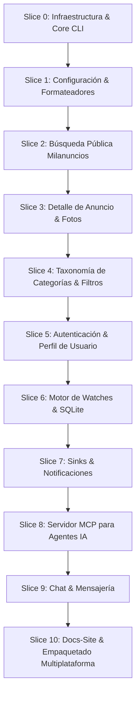

# Milanuncios CLI: Arquitectura, Estrategia de Dominio y Roadmap por Slices Verticales

Este documento define la arquitectura técnica y el plan de implementación iterativo por **slices verticales pequeños** para construir **`milanuncios-cli`**, adaptando los principios de excelencia de `wallapop-cli` a las particularidades técnicas de **Milanuncios** (Adevinta Spain).

---

## 1. Mapeo de Dominio: De Wallapop a Milanuncios

| Concepto | Wallapop CLI | Milanuncios CLI | Particularidades en Milanuncios |
|---|---|---|---|
| **Publicación / Anuncio** | `Item` (hash alfanumérico de 12 chars) | `Ad` o `Item` (ID numérico de anuncio `r...` o numérico puro) | Milanuncios estructura sus anuncios por identificador numérico visible en URLs (`/anuncios/...-492817294.htm`). |
| **Vendedor / Anunciante** | `Seller` / `User` (hash alfanumérico) | `Advertiser` / `User` | Clasificación entre particular y profesional/tienda. |
| **Ubicación** | Latitud, longitud y radio en km | Provincia, municipio y código postal | Históricamente Milanuncios se ha basado en divisiones territoriales españolas (provincias y municipios), con coordenadas geográficas añadidas en la versión moderna. |
| **Categorías** | Árbol plano/semi-anidado de Wallapop | Taxonomía jerárquica profunda (Motor, Inmobiliaria, Empleo, Formación, Segunda Mano, Servicios) | Cada categoría cuenta con metadatos y atributos altamente específicos (ej. km, año, combustible en coches; habitaciones, m² en casas). |
| **Autenticación** | NextAuth + Keycloak (`__Secure-next-auth.session-token`) | Adevinta SSO / Sesión Web (`token` / cookies de sesión Adevinta) | Se adopta la misma política segura: importación de cookies de sesión web del navegador del usuario. Cero contraseñas en memoria ni en disco. |
| **Protección Bot / WAF** | CloudFront | Akamai / Datadome / Cloudflare | Detección de bloqueos HTML o 429, enfriamiento automático preventivo (15 minutos) y soporte estricto de proxies sin fugas. |

---

## 2. Lenguaje Formal del Dominio (`AGENTS.md`)

Para que tanto desarrolladores humanos como Agentes IA operen con coherencia semántica:

- **`Ad`** (o **`Item`**): Un anuncio publicado en Milanuncios. Identificado por su ID o URL canónica. *(Evitar: listing, post, producto, classified).*
- **`Advertiser`** (o **`User`**): La persona o negocio que publica el anuncio. *(Evitar: owner, vendor, poster).*
- **`Search`**: Consulta de búsqueda que combina palabras clave, filtros (precio, provincia, categoría) y ordenación. *(Evitar: query).*
- **`Watch`**: Instrucción local de monitoreo para observar periódicamente una búsqueda o un anuncio específico. Vive 100% en local en SQLite. *(Evitar: alert, tracker, monitor).*
- **`Check`**: Una comprobación puntual e idempotente de un Watch. *(Evitar: poll, tick, cron).*
- **`Event`**: Cambio detectado durante un Check (`ad.new`, `ad.price_changed`, `ad.removed`). *(Evitar: notification).*
- **`Sink`**: Destino de entrega de eventos externo a la consola (`ntfy`, `webhook`, `exec`).

---

## 3. Contrato de Entrada/Salida (I/O) y Códigos de Retorno

Siguiendo el estándar probado en `wallapop-cli`:

1. **Flujo de datos**:
   - `stdout`: Únicamente datos puros. Predeterminado en `json`. Flags `--format pretty` (tablas legibles para humanos), `--format jsonl` (streaming para eventos) y `--format toon` (notación optimizada en tokens para agentes LLM).
   - `stderr`: Trazas de depuración (`--debug`), mensajes de estado, prompts interactivos y errores.
2. **Códigos de Salida Semánticos**:
   - `0`: Operación exitosa (o sin cambios en checks).
   - `1`: Error genérico / inesperado.
   - `2`: Error de uso (flags desconocidas, argumentos inválidos).
   - `3`: Error de autenticación (sesión no configurada o expirada).
   - `4`: Recurso no encontrado (anuncio o usuario inexistente).
   - `5`: Bloqueado por WAF / rate limit (requiere enfriamiento preventivo).
   - `6`: Error de red o proxy inaccesible.
   - `7`: La API de Milanuncios cambió su estructura (genera enlace issue prellenado).
   - `130`: Interrupción por el usuario (`Ctrl+C`).

---

## 4. Roadmap por Slices Verticales de Implementación

Cada slice representa un incremento vertical funcional, entregable y comprobable de extremo a extremo, con sus propios tests unitarios, commits y Pull Request pequeño.

---

### Slice 0: Infraestructura, Tooling y Esqueleto del CLI
- **Objetivo**: Inicializar el repositorio Go con arquitectura limpia, árbol Cobra, Makefile, pipeline CI y chequeos de calidad.
- **Entregables**:
  - `go.mod` inicializado para `github.com/gek0v/milanuncios-cli`.
  - Estructura de paquetes: `cmd/milanuncios/`, `internal/cli/`, `internal/output/`, `internal/config/`.
  - Comando raíz con flags globales: `--format`, `--error-format`, `--no-color`, `--no-input`, `--debug`.
  - `Makefile` (`build`, `test`, `check`, `fmt`, `vet`, `lint`).
  - `.github/workflows/ci.yml` configurado y activo.

### Slice 1: Protocolo de Formateo, Errores y Configuración
- **Objetivo**: Contrato I/O riguroso, clasificador de errores y gestión de archivos de configuración XDG.
- **Entregables**:
  - `internal/output`: Renderizador `json`, `jsonl`, `pretty` (con tablas tabwriter) y soporte `toon`.
  - Manejo de códigos de salida (0 a 130) y envoltorio de error JSON en `stderr`.
  - `internal/config`: Carga y guardado de `$XDG_CONFIG_HOME/milanuncios-cli/config.toml` con `pelletier/go-toml/v2`.
  - Subcomando `milanuncios config {path|get|set|list}`.

### Slice 2: Cliente Core de Milanuncios & Búsqueda Pública
- **Objetivo**: Búsqueda en el catálogo público de Milanuncios sin necesidad de login.
- **Entregables**:
  - `internal/milanuncios/client.go`: Cliente HTTP con headers adecuados, timeout, manejo de proxies y retry con browser UA ante bloqueos.
  - `internal/milanuncios/search.go`: Consumo de la API / endpoints web de búsqueda de Milanuncios.
  - Subcomando `milanuncios search [keywords]`:
    - Flags: `--min-price`, `--max-price`, `--province`, `--category`, `--sort`, `--limit`, `--next`.
  - Tests unitarios con `httptest.Server` y fixtures reales.

### Slice 3: Inspección de Anuncios y Vendedores
- **Objetivo**: Ver fichas detalladas de anuncios y anunciantes.
- **Entregables**:
  - `internal/milanuncios/ads.go` y `users.go`.
  - Subcomandos:
    - `milanuncios ad show <id|url>` (o `item show`).
    - `milanuncios ad images <id|url>`.
    - `milanuncios ad open <id|url>` (apertura en navegador del sistema).
    - `milanuncios user show <id|url>`.
    - `milanuncios user ads <id|url>`.

### Slice 4: Taxonomía y Filtros Específicos
- **Objetivo**: Navegación por el árbol de categorías de Milanuncios y descubrimiento de filtros dinámicos.
- **Entregables**:
  - Subcomandos:
    - `milanuncios category list`.
    - `milanuncios search filters --category <id>`.
  - Flag `--filter clave=valor` repetible para atributos específicos (ej. marca, combustible, tipo de inmueble).

### Slice 5: Autenticación, Bóveda de Sesiones y Perfiles
- **Objetivo**: Permitir acciones autenticadas mediante importación de cookies de sesión web.
- **Entregables**:
  - Asistente interactivo `milanuncios auth login [--cookies <archivo>]`.
  - Almacenamiento seguro en `$XDG_CONFIG_HOME/milanuncios-cli/credentials.toml` (0600).
  - Subcomandos:
    - `milanuncios auth status [--check]`.
    - `milanuncios auth logout`.
    - `milanuncios profile {list|use|remove}`.
    - `milanuncios me {show|ads|favorites}`.
    - `milanuncios ad favorite / unfavorite <id>`.

### Slice 6: Motor de Monitoreo Local (Watches) con SQLite
- **Objetivo**: Observar cambios en búsquedas o anuncios sin depender de la nube.
- **Entregables**:
  - `internal/store`: Esquema SQLite puro con `modernc.org/sqlite` en `$XDG_DATA_HOME/milanuncios-cli/state.db`.
  - `internal/watch`: Algoritmo de diffing e instantáneas para detectar `ad.new`, `ad.price_changed`, `ad.removed`.
  - Subcomandos:
    - `milanuncios watch add search|ad`.
    - `milanuncios watch check [--all]`.
    - `milanuncios watch run [--interval <duración>]`.
    - `milanuncios watch list / remove / events`.

### Slice 7: Sinks de Notificación Externa
- **Objetivo**: Enviar alertas a canales externos cuando un Watch detecta cambios.
- **Entregables**:
  - `internal/sink`: Integración con `ntfy`, webhooks (Discord / Slack) y scripts locales (`exec` vía stdin).
  - Subcomandos:
    - `milanuncios sink list`.
    - `milanuncios sink test <nombre>`.

### Slice 8: Servidor MCP (*Model Context Protocol*) para IA
- **Objetivo**: Interfaz nativa para que modelos de IA usen Milanuncios como herramienta.
- **Entregables**:
  - `internal/mcp`: Servidor JSON-RPC 2.0 por `stdio` que conecta con los comandos del CLI.
  - Subcomandos:
    - `milanuncios mcp`.
    - `milanuncios mcp install {claude-code|codex|cursor}`.
  - Skill embebido en el binario (`milanuncios skills get milanuncios-usage`).

### Slice 9: Mensajería y Chat en Milanuncios
- **Objetivo**: Gestión de conversaciones con anunciantes si el servicio web lo permite.
- **Entregables**:
  - `milanuncios chat list`, `show`, `send`, `start`.

### Slice 10: Docs-Site, Auto-actualización y Distribución
- **Objetivo**: Sitio web de documentación pública, empaquetado y releases.
- **Entregables**:
  - Generador automático de documentación de comandos (`cmd/docsgen`).
  - Sitio web de documentación con Next.js + Fumadocs en `docs-site/`.
  - Configuración de `.goreleaser.yaml` para Linux, macOS y Windows.
  - Paquete npm wrapper y script de instalación `curl | sh`.
