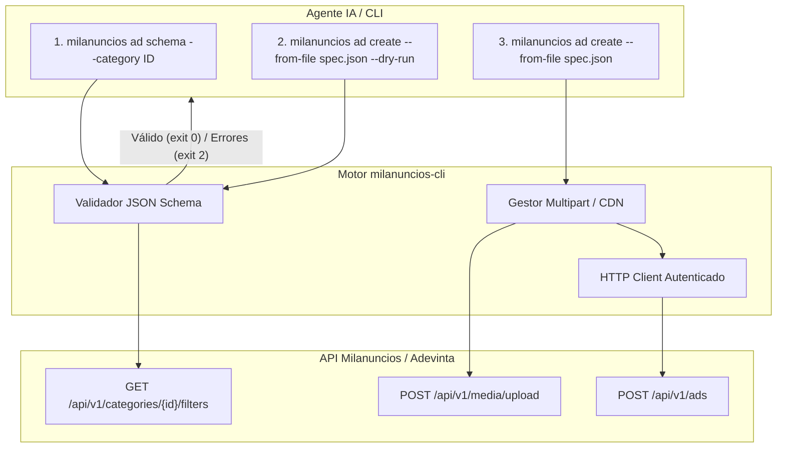
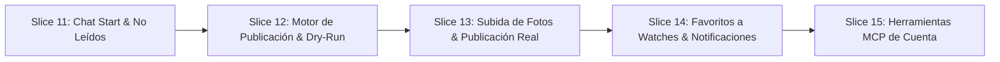

# Especificación Técnica de Acciones de Cuenta (Agent-First Architecture)

**Documento:** `docs/milanuncios-cli/02-account-actions-specification.md`  
**Estado:** Aprobado para diseño e implementación (Slices 11–15)  
**Audiencia:** Agentes Autónomos de IA (Claude Code, Cursor, Codex, Antigravity) y desarrolladores core.  
**Filosofía:** *Agent-First*, estricta separación I/O, idempotencia, descubrimiento declarativo de esquemas y validación previa sin efectos secundarios (*dry-run*).

---

## 1. Visión y Principios Fundamentales para Agentes IA

Las acciones autenticadas (publicar anuncios, chatear, leer conversaciones y gestionar favoritos) deben diseñarse bajo las siguientes garantías operativas:

1. **Descubrimiento Autónomo de Esquemas (*Schema Introspection*)**:
   Un agente LLM no debe adivinar los atributos de una categoría (ej. si `combustible` admite `"diésel"` o `"gasoil"`). El CLI debe exponer un comando declarativo (`milanuncios ad schema --category <id>`) que devuelva el **JSON Schema** exacto con enums, tipos y campos obligatorios.
2. **Validación en Seco Idempotente (*Dry-Run Simulation*)**:
   Todo comando que altere el estado (`ad create`, `ad update`, `ad delete`) debe admitir `--dry-run`. El agente envía su payload; el CLI valida esquemas, existencia de imágenes, reglas de negocio y permisos contra Milanuncios, retornando un diagnóstico sin publicar ni gastar cuotas.
3. **Idempotencia y Claves de Petición (*Request Deduplication*)**:
   Para evitar que reintentos tras timeouts de red publiquen anuncios duplicados o reenvíen mensajes de chat, los payloads admiten un `client_request_id` (UUIDv4) enviado en cabecera y cuerpo.
4. **Ingesta Polimórfica de Imágenes**:
   Los agentes en sandboxes o entornos remotos pueden no tener imágenes en el filesystem local. Se soportan tres orígenes de fotos:
   - Rutas locales: `"./assets/front.jpg"`
   - URLs remotas: `"https://storage.googleapis.com/.../img.png"` (descargadas y subidas a la CDN de Milanuncios)
   - Data URIs en Base64: `"data:image/jpeg;base64,..."`
5. **Contrato de Salida Estricto (I/O Separation)**:
   - `stdout`: Payload JSON puro (o TOON si se especifica `--format toon`).
   - `stderr`: Avisos, progreso de subida multipart, trazas de depuración y diagnósticos de validación.

---

## 2. Protocolo de Red y Autenticación de Adevinta Spain

### 2.1. Sesión y Cabeceras
Milanuncios opera bajo la infraestructura unificada de Adevinta Spain (SSO). Las peticiones autenticadas exigen:

```http
POST /api/v1/ads HTTP/1.1
Host: www.milanuncios.com
User-Agent: milanuncios-cli/0.1.2 (+https://github.com/gek0v/milanuncios-cli)
Authorization: Bearer <session_token>
Cookie: token=<session_token>
X-Adevinta-App-Id: milanuncios-web
X-Client-Request-Id: 550e8400-e29b-41d4-a716-446655440000
Content-Type: application/json
Accept: application/json
```

### 2.2. Seguridad de Credenciales
- Las credenciales se leen desde `$XDG_CONFIG_HOME/milanuncios-cli/credentials.toml` (permisos `0600`).
- Prohibición estricta: Los tokens y contraseñas de proxies nunca deben figurar en `stdout`, ni en trazas de error (`output.Envelope`), ni en URLs de issues.
- En caso de expiración (HTTP 401), se emite el código semántico `3` (`KindAuth`) con el comando sugerido `milanuncios auth login`.

---

## 3. Especificación Técnica por Capacidad



---

### 3.1. Publicación de Anuncios (`ad create`, `ad schema`, `ad edit`, `ad delete`)

#### A. Descubrimiento de Esquema: `milanuncios ad schema`
Permite al agente consultar las reglas y atributos permitidos para una categoría antes de generar el anuncio.

* **Comando:** `milanuncios ad schema --category <id> [--format json]`
* **Salida JSON:**
```json
{
  "$schema": "http://json-schema.org/draft-07/schema#",
  "category_id": 11,
  "category_name": "Coches de segunda mano",
  "required": ["title", "description", "price", "province", "attributes.fuel", "attributes.year"],
  "properties": {
    "title": { "type": "string", "minLength": 10, "maxLength": 100 },
    "description": { "type": "string", "minLength": 20, "maxLength": 5000 },
    "price": { "type": "number", "minimum": 0 },
    "attributes": {
      "type": "object",
      "properties": {
        "fuel": {
          "type": "string",
          "enum": ["diesel", "gasolina", "electrico", "hibrido", "hibrido_enchufable", "gas"],
          "description": "Tipo de combustible del vehículo"
        },
        "year": { "type": "integer", "minimum": 1950, "maximum": 2027 },
        "km": { "type": "integer", "minimum": 0 },
        "transmission": { "type": "string", "enum": ["manual", "automatico"] }
      }
    }
  }
}
```

#### B. Especificación del Anuncio (`AdSpec` JSON)
El agente compone un archivo JSON declarativo:

```json
{
  "client_request_id": "550e8400-e29b-41d4-a716-446655440000",
  "title": "Bicicleta Gravel Cannondale Topstone 1",
  "description": "Talla M, cuadro de aluminio SmartForm C2, transmisión completa Shimano GRX 800/600 2x11. Muy cuidada, cubiertas tubelizadas.",
  "price": 1250.0,
  "category_id": 11,
  "location": {
    "province": "Madrid",
    "municipality": "Madrid",
    "postal_code": "28001"
  },
  "contact": {
    "phone": "600112233",
    "allow_phone": false,
    "allow_chat": true,
    "email": "usuario@ejemplo.com"
  },
  "shipping": {
    "allowed": true,
    "weight_kg": 11.5
  },
  "photos": [
    "./assets/bici_lateral.jpg",
    "./assets/transmision.jpg",
    "https://storage.example.com/bici_manillar.jpg"
  ],
  "attributes": {
    "brand": "Cannondale",
    "frame_size": "M",
    "brake_type": "disco_hidraulico"
  }
}
```

#### C. Modos de Ejecución
1. **Validación previa en seco (`--dry-run`)**:
   ```bash
   milanuncios ad create --from-file ./ad.json --dry-run --format json
   ```
   *Salida si falla validación (Exit Code 2):*
   ```json
   {
     "valid": false,
     "errors": [
       {
         "field": "attributes.fuel",
         "code": "missing_required_attribute",
         "message": "Category 11 requires attribute 'fuel'"
       },
       {
         "field": "photos[0]",
         "code": "file_not_found",
         "message": "File './assets/bici_lateral.jpg' does not exist"
       }
     ]
   }
   ```
   *Salida si es válido (Exit Code 0):*
   ```json
   {
     "valid": true,
     "category_id": 11,
     "estimated_media_count": 3,
     "message": "Validation passed. Ready to publish."
   }
   ```

2. **Publicación real (desde archivo o stdin)**:
   ```bash
   milanuncios ad create --from-file ./ad.json
   # O por tubería (pipeline para scripts y agentes):
   cat ad.json | milanuncios ad create --from-file -
   ```
   *Salida exitosa (Exit Code 0):*
   ```json
   {
     "id": "492817294",
     "title": "Bicicleta Gravel Cannondale Topstone 1",
     "price": 1250.0,
     "status": "published",
     "url": "https://www.milanuncios.com/bicicletas/bicicleta-gravel-cannondale-492817294.htm",
     "photos_uploaded": 3,
     "created_at": "2026-11-17T22:45:00Z"
   }
   ```

3. **Edición y Ciclo de Vida**:
   ```bash
   # Modificar precio y/o título
   milanuncios ad update 492817294 --price 1190 --format json
   # Marcar como vendido o retirar
   milanuncios ad delete 492817294 --reason "sold"
   # Renovar / subir posición en catálogo
   milanuncios ad renew 492817294
   ```

---

### 3.2. Enviar Mensajes (`chat start`, `chat send`)

#### A. Iniciar Conversación desde un Anuncio (`chat start`)
Permite al agente contactar al vendedor de un anuncio específico por primera vez.

* **Comando:**
  ```bash
  milanuncios chat start <ad-id|url> "¿Sigue disponible? Me interesa recogerla en mano en Madrid."
  ```
* **Contrato de Red:**
  - `POST /api/v1/ads/{ad_id}/contact`
  - Payload:
    ```json
    {
      "ad_id": "492817294",
      "text": "¿Sigue disponible? Me interesa recogerla en mano en Madrid.",
      "client_request_id": "9b1deb4d-3b7d-4bad-9bdd-2b0d7b3dcb6d"
    }
    ```
* **Salida Exitosa (Exit Code 0):**
  ```json
  {
    "conversation_id": "conv-8849201",
    "ad_id": "492817294",
    "recipient_name": "Carlos M.",
    "message_id": "msg-1001",
    "text": "¿Sigue disponible? Me interesa recogerla en mano en Madrid.",
    "sent_at": "2026-11-17T22:46:10Z"
  }
  ```
* **Casos de Error Específicos:**
  - Si el anuncio ya no existe: Código de salida 4 (`NotFound`).
  - Si el anuncio pertenece al propio usuario: Código de salida 2 (`UsageError: cannot start conversation on your own ad`).
  - Si la conversación ya existía: Retorna el `conversation_id` existente y envía el mensaje sin duplicar hilos.

#### B. Responder en Hilo Existente (`chat send`)
* **Comando:**
  ```bash
  milanuncios chat send <conversation-id> "De acuerdo, quedamos mañana a las 18:00."
  ```
* **Contrato de Red:**
  - `POST /api/v1/conversations/{conv_id}/messages`
  - Payload en body JSON con `Content-Type: application/json`:
    ```json
    {
      "text": "De acuerdo, quedamos mañana a las 18:00.",
      "client_request_id": "..."
    }
    ```

---

### 3.3. Leer Mensajes y Monitoreo de Chat (`chat list`, `chat show`, `chat watch`)

#### A. Listar Conversaciones con Filtros
* **Comandos:**
  ```bash
  # Todas las conversaciones
  milanuncios chat list --limit 20
  # Solo conversaciones con mensajes no leídos
  milanuncios chat list --unread-only
  ```
* **Estructura de Salida (`Conversation`):**
  ```json
  [
    {
      "id": "conv-8849201",
      "ad_id": "492817294",
      "ad_title": "Bicicleta Gravel Cannondale",
      "ad_price": 1250.0,
      "ad_photo": "https://img.milanuncios.com/.../thumb.jpg",
      "opponent": {
        "id": "user-5541",
        "name": "Carlos M.",
        "type": "individual"
      },
      "last_message": {
        "id": "msg-1002",
        "text": "Sí, sigue disponible. Vivo cerca de Nuevos Ministerios.",
        "sent_at": "2026-11-17T22:48:00Z",
        "from_me": false,
        "read": false
      },
      "unread_count": 1
    }
  ]
  ```

#### B. Inspeccionar Historial Completo (`chat show`)
* **Comando:** `milanuncios chat show <conversation-id> [--limit 50]`
* Muestra la cronología de mensajes ordenados cronológicamente (`sent_at ASC`).
* Marca automáticamente la conversación como leída (`POST /api/v1/conversations/{id}/read`).

#### C. Demonio de Monitoreo de Chat (`chat watch`)
* **Objetivo:** Avisar al agente o al usuario en tiempo real cuando un comprador/vendedor envía un mensaje.
* **Comando:** `milanuncios watch add chat [--interval 30s]` o demonio `milanuncios chat watch`.
* **Emisión de Eventos:**
  Cuando un mensaje entrante (`from_me: false`) no ha sido visto:
  ```json
  {
    "event_type": "chat.message_received",
    "conversation_id": "conv-8849201",
    "ad_id": "492817294",
    "sender_name": "Carlos M.",
    "text": "Sí, sigue disponible. Vivo cerca de Nuevos Ministerios.",
    "sent_at": "2026-11-17T22:48:00Z"
  }
  ```
  El evento se despacha automáticamente a los sinks configurados en `milanuncios-cli` (`ntfy`, webhook de Discord/Slack o script local).

---

### 3.4. Guardar y Gestionar Favoritos con Sincronización Automática

#### A. Comandos Básicos
* Añadir favorito: `milanuncios ad favorite <id|url>` -> `{"status": "favorited", "ad_id": "492817294"}`
* Quitar favorito: `milanuncios ad unfavorite <id|url>` -> `{"status": "unfavorited", "ad_id": "492817294"}`
* Listar favoritos: `milanuncios me favorites [--format pretty|json|toon]`

#### B. Sincronización Automática con Watches (`watch add favorites`)
* **Problema:** El usuario o un agente tiene decenas de favoritos y quiere saber al instante si alguno baja de precio o es retirado.
* **Solución:**
  ```bash
  milanuncios watch add favorites --interval 10m
  ```
* **Mecánica:**
  1. El engine ejecuta periódicamente `GET /api/v1/me/favorites`.
  2. Crea y actualiza automáticamente los registros en la tabla `seen_items` para cada favorito.
  3. Si un favorito baja de precio, emite `ad.price_changed`.
  4. Si un favorito se elimina o se vende, emite `ad.removed` y pausa el tracking de ese ID.

#### C. Metadatos de Agente para Favoritos (Anotaciones Locales)
Para permitir que un agente mantenga notas sobre los anuncios analizados:
```bash
milanuncios favorite tag 492817294 "posible_compra" --note "Ofrecer 1100€ si no incluye pedales"
```
Los datos se almacenan en SQLite local sin alterar los favoritos en Milanuncios.

---

## 4. Definición Exhaustiva de Herramientas MCP (*Model Context Protocol*)

El servidor `milanuncios mcp` incorporará las siguientes herramientas nativas JSON-RPC 2.0:

### 1. `milanuncios_ad_schema`
```json
{
  "name": "milanuncios_ad_schema",
  "description": "Inspect required attributes, enums, price ranges, and validation constraints for publishing in a specific category.",
  "inputSchema": {
    "type": "object",
    "properties": {
      "category_id": { "type": "integer", "description": "Numeric Milanuncios category ID (e.g. 11 for cars)" }
    },
    "required": ["category_id"]
  }
}
```

### 2. `milanuncios_ad_create`
```json
{
  "name": "milanuncios_ad_create",
  "description": "Create a new classified ad on Milanuncios. Always run with dry_run=true first to validate your parameters before publishing.",
  "inputSchema": {
    "type": "object",
    "properties": {
      "title": { "type": "string", "description": "Title between 10 and 100 characters" },
      "description": { "type": "string", "description": "Detailed description between 20 and 5000 characters" },
      "price": { "type": "number", "minimum": 0, "description": "Price in Euros (€)" },
      "category_id": { "type": "integer", "description": "Target category ID" },
      "province": { "type": "string", "description": "Spanish province name (e.g. Madrid, Barcelona, Valencia)" },
      "postal_code": { "type": "string", "description": "5-digit Spanish postal code" },
      "photos": {
        "type": "array",
        "items": { "type": "string" },
        "description": "List of local file paths, remote URLs, or base64 data URIs to upload as listing photos"
      },
      "shipping_allowed": { "type": "boolean", "default": false },
      "attributes": {
        "type": "object",
        "description": "Category-specific dynamic attributes according to milanuncios_ad_schema",
        "additionalProperties": { "type": "string" }
      },
      "dry_run": {
        "type": "boolean",
        "default": true,
        "description": "When true, validates attributes, category rules, and image accessibility without publishing"
      }
    },
    "required": ["title", "description", "price", "category_id", "province"]
  }
}
```

### 3. `milanuncios_chat_start`
```json
{
  "name": "milanuncios_chat_start",
  "description": "Initiate a chat conversation with the seller of a Milanuncios listing.",
  "inputSchema": {
    "type": "object",
    "properties": {
      "ad_id": { "type": "string", "description": "Numeric ad ID or listing URL" },
      "message": { "type": "string", "description": "Initial text message to send" }
    },
    "required": ["ad_id", "message"]
  }
}
```

### 4. `milanuncios_chat_send`
```json
{
  "name": "milanuncios_chat_send",
  "description": "Send a reply message in an existing conversation thread.",
  "inputSchema": {
    "type": "object",
    "properties": {
      "conversation_id": { "type": "string", "description": "Conversation ID returned by chat_list or chat_start" },
      "message": { "type": "string", "description": "Text message payload" }
    },
    "required": ["conversation_id", "message"]
  }
}
```

### 5. `milanuncios_chat_list`
```json
{
  "name": "milanuncios_chat_list",
  "description": "List active chat conversations with last message preview and unread status.",
  "inputSchema": {
    "type": "object",
    "properties": {
      "unread_only": { "type": "boolean", "default": false, "description": "Filter conversations with unread messages" },
      "limit": { "type": "integer", "default": 20, "maximum": 50 }
    }
  }
}
```

### 6. `milanuncios_chat_show`
```json
{
  "name": "milanuncios_chat_show",
  "description": "Get chronological message history for a conversation thread and mark it as read.",
  "inputSchema": {
    "type": "object",
    "properties": {
      "conversation_id": { "type": "string" }
    },
    "required": ["conversation_id"]
  }
}
```

### 7. `milanuncios_ad_favorite`
```json
{
  "name": "milanuncios_ad_favorite",
  "description": "Add an ad listing to account favorites.",
  "inputSchema": {
    "type": "object",
    "properties": {
      "ad_id": { "type": "string", "description": "Numeric ad ID or URL" }
    },
    "required": ["ad_id"]
  }
}
```

---

## 5. Modelos de Estructuras en Go (`internal/milanuncios/`)

```go
package milanuncios

import "time"

// AdSpec represents the full declarative specification for creating an ad.
type AdSpec struct {
    ClientRequestID string            `json:"client_request_id,omitempty"`
    Title           string            `json:"title"`
    Description     string            `json:"description"`
    Price           float64           `json:"price"`
    CategoryID      int               `json:"category_id"`
    Location        AdLocationSpec    `json:"location"`
    Contact         AdContactSpec     `json:"contact,omitempty"`
    Shipping        AdShippingSpec    `json:"shipping,omitempty"`
    Photos          []string          `json:"photos,omitempty"`
    Attributes      map[string]string `json:"attributes,omitempty"`
}

type AdLocationSpec struct {
    Province     string `json:"province"`
    Municipality string `json:"municipality,omitempty"`
    PostalCode   string `json:"postal_code,omitempty"`
}

type AdContactSpec struct {
    Phone      string `json:"phone,omitempty"`
    AllowPhone bool   `json:"allow_phone"`
    AllowChat  bool   `json:"allow_chat"`
    Email      string `json:"email,omitempty"`
}

type AdShippingSpec struct {
    Allowed  bool    `json:"allowed"`
    WeightKG float64 `json:"weight_kg,omitempty"`
}

// ValidationReport provides machine-readable dry-run diagnostics.
type ValidationReport struct {
    Valid    bool              `json:"valid"`
    Errors   []ValidationError `json:"errors,omitempty"`
    Warnings []string          `json:"warnings,omitempty"`
}

type ValidationError struct {
    Field   string `json:"field"`
    Code    string `json:"code"`
    Message string `json:"message"`
}
```

---

## 6. Roadmap de Ejecución por Slices Verticales



| Slice | Nombre | Entregables Principales | Criterios de Aceptación |
|---|---|---|---|
| **Slice 11** | Iniciar Chats & Filtros de Conversación | `chat start <ad-id> <msg>`, `chat list --unread-only`, `client.StartConversation` | Cobertura en `client_test.go` y E2E: comprobar que enviar mensaje a anuncio ajeno devuelve nuevo hilo; error 2 en anuncio propio; error 4 en anuncio inexistente. |
| **Slice 12** | Motor Declarativo de Publicación & Dry-Run | `ad schema --category <id>`, `ad create --from-file <f> --dry-run`, validación contra taxonomía | Generación de JSON Schema por categoría. `--dry-run` retorna Exit Code 0 en schemas válidos y Exit Code 2 con diagnósticos estructurados en inválidos. |
| **Slice 13** | Subida Multipart de Fotos & Publicación Real | Subida a CDN (`client.UploadPhoto`), `ad create` completo, `ad update <id>`, `ad delete <id>` | Acepta fotos locales, URLs y base64. Publicación en endpoint real. Eliminación con motivo ("sold"). |
| **Slice 14** | Sincronización Favoritos -> Watches & Chat Watch | `watch add favorites`, demonio `chat watch` o evento `chat.message_received` a sinks | Los favoritos se monitorizan en background sin añadirlos manualmente. Nuevos mensajes en chats emiten notificación instantánea por `ntfy` o webhook. |
| **Slice 15** | Integración Completa en MCP para Agentes | 7 MCP Tools registradas en `mcp/server.go`, actualización de skill prompts | Los agentes en Claude Code o Cursor pueden invocar `milanuncios_ad_create`, `milanuncios_chat_start`, etc., recibiendo errores tipados y schemas limpios. |

---

## 7. Directrices de Robustez y Recuperación para Agentes

1. **Gestión de Errores Semánticos**:
   - `401 Unauthorized`: El agente debe pausar la tarea y notificar al usuario: *"Tu sesión de Milanuncios ha expirado. Por favor, ejecuta `milanuncios auth login`"*.
   - `403/429 Blocked / Rate-Limited`: El CLI activa automáticamente un cooldown de 15 minutos y retorna código 5. El agente no debe reintentar en bucle cerrado.
   - `422 Unprocessable Entity`: Errores de validación devuelven el array `errors` con el campo exacto que causó el rechazo para que el agente autocorrija el JSON sin intervención humana.
2. **Idempotencia Garantizada**:
   - Si una llamada de red falla con timeout (`KindNetwork`, código 6), el agente puede reintentar con el mismo `client_request_id` sin riesgo de doble publicación.
