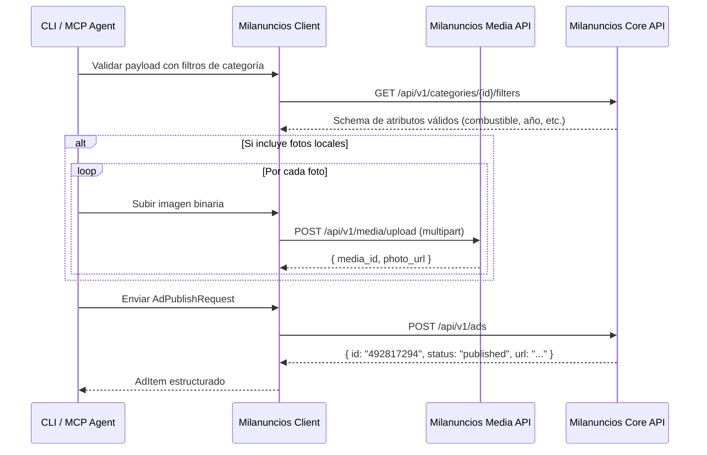
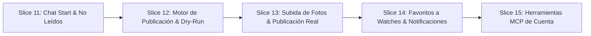

# Especificación Técnica y Plan de Implementación: Acciones de Cuenta en Milanuncios CLI

Este documento detalla la arquitectura, contratos de datos, interfaz CLI, herramientas MCP y plan de ejecución por slices verticales para la implementación completa de las **acciones que requieren cuenta y autenticación** en `milanuncios-cli`:

1. **Publicar Anuncios** (`ad create`, `ad update`, `ad delete`, `ad images upload`)
2. **Enviar Mensajes** (`chat send`, `chat start <ad-id>`)
3. **Leer Mensajes** (`chat list`, `chat show`, `chat watch`, `chat unread`)
4. **Guardar Favoritos** (`ad favorite`, `ad unfavorite`, `me favorites`, `watch add favorites`)

---

## 1. Matriz de Estado Actual vs. Estado Objetivo

| Capacidad | Estado Actual | Estado Objetivo | Componentes Involucrados |
|---|---|---|---|
| **Publicar anuncio** | No implementado | Creación declarativa (`--from-file ad.json`), flags directas, subida de fotos multipart y validación previa (`--dry-run`). | `internal/milanuncios/publish.go`, `internal/cli/ad_publish.go`, `internal/mcp/tools.go` |
| **Editar / Eliminar anuncio** | No implementado | Modificación de precio/título/descripción y baja de anuncio propio. | `internal/milanuncios/publish.go`, `internal/cli/me_ads.go` |
| **Enviar mensaje (hilo existente)** | Implementado (`chat send <conv-id> <msg>`) con body JSON | Mantenido y enriquecido con soporte de adjuntos opcionales. | `internal/cli/chat.go`, `internal/milanuncios/client.go` |
| **Iniciar conversación desde anuncio** | No implementado | `chat start <ad-id> <mensaje>`: contacta al vendedor creando el hilo de chat. | `internal/milanuncios/chat.go`, `internal/cli/chat.go` |
| **Listar y leer conversaciones** | Implementado (`chat list`, `chat show <id>`) | Filtrado de no leídos (`--unread-only`), marcado como leído (`chat read`). | `internal/cli/chat.go`, `internal/output/` |
| **Monitoreo de mensajes nuevos** | No implementado | Demonio `chat watch` o evento de watch que emite a sinks (`ntfy`, webhook) cuando te escriben. | `internal/watch/chat_engine.go`, `internal/sink/` |
| **Favoritos (añadir / quitar / ver)** | Implementado (`ad favorite`, `ad unfavorite`, `me favorites`) | Sincronización automática de favoritos con el motor de Watches (`watch add favorites`). | `internal/cli/watch.go`, `internal/store/` |
| **Herramientas MCP para IA** | Herramientas de lectura y favoritos | Herramientas MCP para `milanuncios_ad_create`, `milanuncios_chat_start`, `milanuncios_chat_send`. | `internal/mcp/server.go`, `internal/mcp/tools.go` |

---

## 2. Flujo de Autenticación y Seguridad

Todas las acciones de cuenta aprovechan el sistema de autenticación ya implementado en el Slice 5 (`credentials.toml` con permisos `0600`):

1. **Token de Sesión Adevinta / Milanuncios**:
   - Inyectado en las cabeceras HTTP:
     - `Authorization: Bearer <session_token>`
     - `Cookie: token=<session_token>`
   - Redacción automática en logs de debug (`c.redact(token)`).
2. **Manejo de Errores de Autenticación**:
   - HTTP 401 Unauthorized -> `KindAuth` (Código de salida `3`).
   - Sugerencia interactiva automática: `milanuncios auth login`.
3. **Protección Anti-Bot y WAF**:
   - Cuentas autenticadas sujetas a rate limiting estricto de Adevinta.
   - Enfriamiento automático preventivo de 15 minutos en respuestas 429/403 (`KindBlocked`, Código de salida `5`).

---

## 3. Especificación Técnica por Capacidad

### 3.1. Publicación de Anuncios (`ad create` / `ad publish`)

La publicación en Milanuncios requiere tres etapas secuenciales: validación de taxonomía, subida de activos binarios (imágenes) y registro de la entidad de anuncio.



#### Modelo de Datos en Go (`internal/milanuncios/types.go`)

```go
type AdPublishRequest struct {
    Title          string            `json:"title"`
    Description    string            `json:"description"`
    Price          float64           `json:"price"`
    CategoryID     int               `json:"category_id"`
    Province       string            `json:"province"`
    Municipality   string            `json:"municipality,omitempty"`
    PostalCode     string            `json:"postal_code,omitempty"`
    ContactPhone   string            `json:"contact_phone,omitempty"`
    ContactEmail   string            `json:"contact_email,omitempty"`
    AllowChat      bool              `json:"allow_chat"`
    Shipping       bool              `json:"shipping"`
    Photos         []string          `json:"photos,omitempty"` // URLs o Photo IDs
    Attributes     map[string]string `json:"attributes,omitempty"` // Filtros dinámicos
}

type AdPublishResult struct {
    ID        string    `json:"id"`
    Title     string    `json:"title"`
    Price     float64   `json:"price"`
    URL       string    `json:"url"`
    Status    string    `json:"status"` // "published", "pending_review", "draft"
    CreatedAt time.Time `json:"created_at"`
}
```

#### Comandos de CLI Planificados

1. **Creación declarativa (Archivo JSON o stdin)**:
   ```bash
   milanuncios ad create --from-file ./anuncio.json
   cat anuncio.json | milanuncios ad create --from-file -
   ```
2. **Creación mediante flags directas**:
   ```bash
   milanuncios ad create \
     --title "Bicicleta Gravel Cannondale Topstone" \
     --description "Talla M, cuadro aluminio, transmisión Shimano GRX. Perfecto estado." \
     --price 1150 \
     --category 11 \
     --province "Madrid" \
     --postal-code "28001" \
     --photo "./foto1.jpg" --photo "./foto2.jpg" \
     --shipping \
     --attr "brand=Cannondale" --attr "frame_size=M"
   ```
3. **Modo validación en seco (`--dry-run`)**:
   Valida el esquema, atributos requeridos de la categoría y existencia de fotos sin publicar ni gastar cuotas:
   ```bash
   milanuncios ad create --from-file ./anuncio.json --dry-run
   ```
4. **Ciclo de vida posterior**:
   ```bash
   milanuncios ad edit <id> --price 1050
   milanuncios ad delete <id> [--reason "sold"]
   milanuncios ad renew <id>
   ```

---

### 3.2. Enviar Mensajes (`chat send` & `chat start`)

La mensajería cubre dos casos de uso: responder a un chat activo o iniciar un contacto nuevo con un vendedor.

#### Caso 1: Iniciar conversación desde un anuncio (`chat start`)
* **Comando**:
  ```bash
  milanuncios chat start <ad-id|url> "¿Sigue disponible? Me interesa recogerla en mano."
  ```
* **Flujo**:
  1. Extrae el `ad_id` numérico mediante `ExtractAdID`.
  2. Llama a `POST /api/v1/ads/{ad_id}/contact` con el payload:
     ```json
     {
       "ad_id": "492817294",
       "message": "¿Sigue disponible? Me interesa recogerla en mano."
     }
     ```
  3. Devuelve la nueva `Conversation` con su `conversation_id` asignado.

#### Caso 2: Enviar mensaje en conversación existente (`chat send`)
* **Comando actual**:
  ```bash
  milanuncios chat send <conversation-id> "Hola, ¿a qué hora te viene bien quedar?"
  ```
* **Extensión planificada**:
  Soporte de imágenes adjuntas:
  ```bash
  milanuncios chat send <conversation-id> "Aquí tienes la foto del número de serie" --image ./serial.jpg
  ```

---

### 3.3. Leer Mensajes y Monitoreo de Chat

#### Listado y visualización
* `milanuncios chat list`: Lista conversaciones con último mensaje, interlocutor, anuncio asociado y fecha.
* Flag `--unread-only`: Filtra únicamente conversaciones con mensajes pendientes de lectura.
* `milanuncios chat show <conversation-id>`: Historial completo con diferenciación visual de emisor/receptor (`FromMe`).
* `milanuncios chat read <conversation-id>`: Marca el hilo como leído.

#### Demonio de vigilancia de mensajes (`chat watch`)
* **Objetivo**: Permitir a usuarios y agentes IA recibir alertas en tiempo real cuando un comprador responde.
* **Comando**:
  ```bash
  milanuncios chat watch --interval 30s
  ```
* **Funcionamiento**:
  1. Consulta periódicamente `GET /api/v1/conversations`.
  2. Compara el `last_message_id` o `unread_count` contra el estado local en SQLite.
  3. Cuando detecta mensajes nuevos procedentes del interlocutor (`FromMe == false`), emite un evento `chat.message_received`.
  4. Despacha el evento a los sinks configurados (`ntfy` en el móvil, webhook de Discord o script local).

---

### 3.4. Guardar Favoritos & Sincronización Automática

Actualmente existen los comandos puntuales:
* `milanuncios ad favorite <id|url>`
* `milanuncios ad unfavorite <id|url>`
* `milanuncios me favorites`

#### Extensión planificada: Sincronización de Favoritos con Watches
* **Comando**:
  ```bash
  milanuncios watch add favorites [--interval 10m]
  ```
* **Mecánica**:
  1. El engine consulta periódicamente `GET /api/v1/me/favorites`.
  2. Registra cada anuncio favorito como un sub-watch individual de tipo `ad`.
  3. Cuando el vendedor baja el precio o elimina el anuncio, el usuario recibe alerta inmediata vía sus sinks.
  4. Si el usuario desmarca el favorito en la web/app de Milanuncios, el sub-watch se sincroniza en la siguiente pasada.

---

## 4. Herramientas MCP para Agentes IA (*Model Context Protocol*)

Para que Claude Code, Cursor, Codex y asistentes autónomos puedan operar con la cuenta, se incorporarán las siguientes herramientas al servidor MCP stdio (`milanuncios mcp`):

```json
[
  {
    "name": "milanuncios_ad_create",
    "description": "Publish a new listing/ad on Milanuncios. Requires title, description, price, category, and province.",
    "inputSchema": {
      "type": "object",
      "properties": {
        "title": { "type": "string" },
        "description": { "type": "string" },
        "price": { "type": "number" },
        "category_id": { "type": "integer" },
        "province": { "type": "string" },
        "postal_code": { "type": "string" },
        "photos": { "type": "array", "items": { "type": "string" } },
        "attributes": { "type": "object", "additionalProperties": { "type": "string" } },
        "dry_run": { "type": "boolean", "description": "Validate fields and categories without actually publishing" }
      },
      "required": ["title", "description", "price", "category_id", "province"]
    }
  },
  {
    "name": "milanuncios_chat_start",
    "description": "Start a new chat conversation with the seller of an ad listing.",
    "inputSchema": {
      "type": "object",
      "properties": {
        "ad_id": { "type": "string", "description": "Numeric ad ID or full Milanuncios URL" },
        "message": { "type": "string", "description": "Initial text message to send" }
      },
      "required": ["ad_id", "message"]
    }
  },
  {
    "name": "milanuncios_chat_send",
    "description": "Send a reply message in an existing conversation thread.",
    "inputSchema": {
      "type": "object",
      "properties": {
        "conversation_id": { "type": "string" },
        "message": { "type": "string" }
      },
      "required": ["conversation_id", "message"]
    }
  },
  {
    "name": "milanuncios_chat_list",
    "description": "List user's active chat conversations on Milanuncios.",
    "inputSchema": {
      "type": "object",
      "properties": {
        "unread_only": { "type": "boolean" }
      }
    }
  },
  {
    "name": "milanuncios_chat_show",
    "description": "Retrieve full message history for a conversation thread.",
    "inputSchema": {
      "type": "object",
      "properties": {
        "conversation_id": { "type": "string" }
      },
      "required": ["conversation_id"]
    }
  },
  {
    "name": "milanuncios_ad_favorite",
    "description": "Save an ad listing to user account favorites.",
    "inputSchema": {
      "type": "object",
      "properties": {
        "ad_id": { "type": "string" }
      },
      "required": ["ad_id"]
    }
  },
  {
    "name": "milanuncios_me_favorites",
    "description": "List all ads saved in user favorites.",
    "inputSchema": { "type": "object" }
  }
]
```

---

## 5. Roadmap de Ejecución por Slices Verticales



### Slice 11: Iniciar Conversaciones & Filtro de No Leídos
* **Entregables**:
  - `client.StartConversation(ctx, adID, text)` en `internal/milanuncios/client.go`.
  - Subcomando `milanuncios chat start <ad-id|url> <mensaje>` en `internal/cli/chat.go`.
  - Flag `--unread-only` en `milanuncios chat list`.
  - Pruebas unitarias de red y casos de error (401 si no hay sesión, 404 si el anuncio no existe, 400 si el texto está vacío).

### Slice 12: Motor de Publicación & Validación Previa (`--dry-run`)
* **Entregables**:
  - Estructuras `AdPublishRequest` y validación de reglas de negocio en `internal/milanuncios/publish.go`.
  - Validación cruzada con la taxonomía de filtros (`GetCategoryFilters`).
  - Subcomando `milanuncios ad create` con flag `--dry-run` y soporte `--from-file`.
  - Verificación estricta de códigos de salida (Código 2 si faltan atributos obligatorios de la categoría).

### Slice 13: Subida de Fotos & Publicación Real
* **Entregables**:
  - Endpoint de carga de medios (`client.UploadPhoto(ctx, filePath)`).
  - Integración completa de `milanuncios ad create` con subida multipart automática de flags `--photo`.
  - Subcomandos de ciclo de vida: `milanuncios ad edit <id>`, `milanuncios ad delete <id>`.

### Slice 14: Sincronización de Favoritos con Watches & Chat Watch
* **Entregables**:
  - Comando `milanuncios watch add favorites` que expande dinámicamente los anuncios favoritos como targets de monitoreo.
  - Comando `milanuncios chat watch --interval 30s` para monitorizar mensajes entrantes y despacharlos a sinks (`ntfy`, webhook).

### Slice 15: Herramientas MCP para Acciones de Cuenta
* **Entregables**:
  - Registro de `milanuncios_ad_create`, `milanuncios_chat_start`, `milanuncios_chat_send`, `milanuncios_chat_list`, `milanuncios_ad_favorite`, `milanuncios_me_favorites` en `internal/mcp/server.go`.
  - Actualización del prompt de skill `milanuncios-usage`.
  - Pruebas unitarias end-to-end de tool calls JSON-RPC 2.0.
