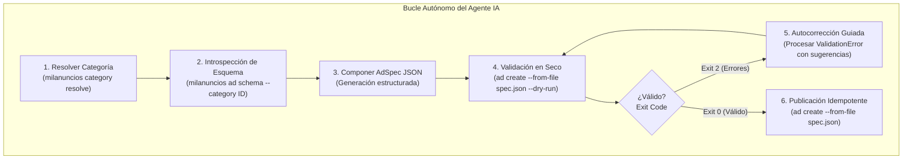
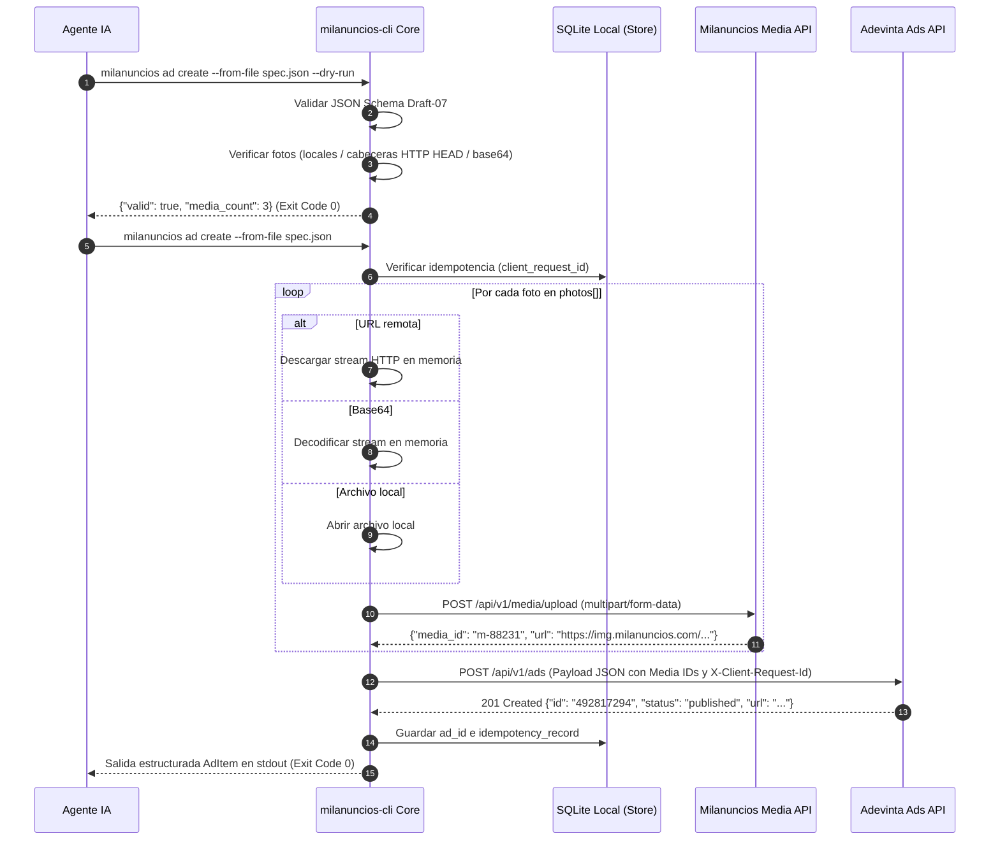
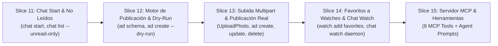

# Especificación Técnica de Acciones de Cuenta (Agent-First Declarative Architecture)

**Documento:** `docs/milanuncios-cli/02-account-actions-specification.md`  
**Versión:** 2.0.0-draft  
**Estado:** Aprobado para diseño e implementación (Slices 11–15)  
**Audiencia:** Agentes Autónomos de IA (Claude Code, Cursor, Codex, OpenCode, Antigravity) y desarrolladores core de `milanuncios-cli`.  
**Filosofía Central:** *Agent-First*, 100% declarativo, estricta separación I/O, introspección formal de esquemas (JSON Schema Draft-07), validación en seco idempotente (*dry-run*), diagnósticos autocorrectivos orientados a LLMs y soporte polimórfico de medios.

---

## 1. Principios Fundamentales de la Arquitectura *Agent-First*

A diferencia de las herramientas CLI convencionales diseñadas para humanos con asistentes interactivos por terminal (TUI, prompts bloqueantes con `readline`), `milanuncios-cli` se concibe como una interfaz declarativa nativa para **Agentes de Inteligencia Artificial**.

Las operaciones sobre cuentas de Milanuncios (publicar, editar, borrar, responder chats, consultar mensajes y gestionar favoritos) se rigen por los siguientes principios operativos:



### 1.1. Modos de Ingesta Declarativa (Cero Prompts Bloqueantes)
Para evitar que un agente se quede colgado esperando entrada por terminal, ningún subcomando requerirá prompts interactivos cuando se ejecute en modos no interactivos o con flags declarativos:
1. **Archivo en disco:** `--from-file <ruta/anuncio.json>`
2. **Entrada estándar (stdin):** `--from-file -` o canalización directa mediante tubería (`cat anuncio.json | milanuncios ad create --from-file -`).
3. **Payload directo en línea de comandos (Inline Spec):** `--spec '{"title": "...", ...}'`. Este modo es óptimo para ejecuciones rápidas en llamadas de herramientas MCP o subagentes sin necesidad de escribir archivos temporales en el filesystem de la sandbox.

### 1.2. Introspección Dinámica de Esquemas (*Schema Introspection*)
Un modelo de lenguaje nunca debe alucinar campos obligatorios ni atributos válidos (ej. si el combustible de un coche se codifica como `"diesel"`, `"gasoil"` o `"D"`).
- El comando `milanuncios ad schema --category <id>` genera un **JSON Schema Draft-07** formal y canónico directamente traducido de los filtros de taxonomía de Adevinta/Milanuncios.
- Incluye tipos de datos, enums exhaustivos, rangos numéricos, límites de longitud de texto y requisitos de fotos (mínimo y máximo).

### 1.3. Validación en Seco con Diagnósticos Autocorrectivos (*Dry-Run Simulation*)
Antes de enviar una petición que altere el estado o gaste cuotas de publicación, el agente invoca `--dry-run`:
- Realiza validación sintáctica contra el JSON Schema.
- Realiza validación semántica de reglas de negocio de Milanuncios (precio > 0, combinación de atributos requeridos).
- Comprueba la accesibilidad y validez de las imágenes especificadas.
- En caso de fallo (Exit Code 2), la salida estructurada en `stdout` proporciona un array de errores con punteros JSON, códigos tipados, valores recibidos, restricciones esperadas y **sugerencias directas de solución (*fix suggestions*)** diseñadas para que el LLM se autocorrija en un solo turno.

### 1.4. Ingesta Polimórfica de Imágenes
Los agentes operan en sandboxes, contenedores Docker efímeros o máquinas remotas. El CLI soporta 4 fuentes de imágenes en el array `photos`:
1. **Rutas locales del sistema:** `"./assets/frontal.jpg"`, `"/tmp/foto.png"`.
2. **URLs remotas HTTP/HTTPS:** `"https://cdn.example.com/bici.jpg"`. El cliente las descarga en streaming a un buffer en memoria, valida su firma mágica y las sube a la CDN de Milanuncios sin requerir que el agente las descargue primero a disco.
3. **Data URIs en Base64:** `"data:image/jpeg;base64,/9j/4AAQ..."`. Ideal para agentes que generan imágenes sintéticas o reciben capturas en memoria.
4. **Media IDs ya subidos:** `"media://milanuncios-cdn/.../img123"`. Permite reutilizar fotos ya subidas previamente sin duplicar transferencias de datos.

### 1.5. Idempotencia y Deduplicación de Peticiones (*Request Idempotency*)
- Todo payload declarativo soporta `client_request_id` (UUIDv4).
- Se envía en la cabecera HTTP `X-Client-Request-Id` y en el cuerpo del mensaje.
- El CLI mantiene una tabla SQLite local (`idempotency_records`). Si una petición falla por timeout de red (Exit Code 6) y el agente la reintenta con el mismo `client_request_id`, el cliente devuelve la respuesta almacenada o asegura que la API remota no cree un anuncio duplicado ni reenvíe un mensaje repetido.

### 1.6. Estricta Separación I/O y Códigos de Salida Semánticos
- `stdout`: Payload 100% estructurado y limpio (`json`, `toon`, `pretty`). Sin banners de bienvenida, barras de progreso ANSI ni textos no estructurados.
- `stderr`: Barras de progreso de subida multipart, trazas de depuración (`--debug`), advertencias operativas y envelopes de error tipados.
- Códigos de salida semánticos:
  - `0`: Éxito total.
  - `2`: Error de validación o schema (`ValidationError`).
  - `3`: Error de autenticación (sesión expirada o ausente).
  - `4`: Recurso no encontrado (anuncio o categoría inexistente).
  - `5`: Bloqueo por WAF o limitación de tasa (*rate limit*).
  - `6`: Fallo de transporte o red (timeout recuperable).

---

## 2. Diagramas de Arquitectura y Secuencia

### 2.1. Pipeline de Publicación Declarativa con Medios Polimórficos



---

## 3. Especificación Técnica del Motor de Publicación

### 3.1. Introspección de Esquema: `milanuncios ad schema`

Permite a cualquier modelo de lenguaje consultar el contrato formal de publicación de una categoría específica antes de componer el anuncio.

* **Sintaxis del Comando:**
  ```bash
  milanuncios ad schema --category <id> [--format json|toon]
  ```
* **Salida Estructurada (JSON Schema Draft-07):**
  ```json
  {
    "$schema": "http://json-schema.org/draft-07/schema#",
    "title": "MilanunciosAdSpec_Category_11",
    "category_id": 11,
    "category_name": "Coches de segunda mano",
    "type": "object",
    "required": [
      "title",
      "description",
      "price",
      "location",
      "attributes.fuel",
      "attributes.year",
      "attributes.km"
    ],
    "properties": {
      "title": {
        "type": "string",
        "minLength": 10,
        "maxLength": 100,
        "description": "Título descriptivo del vehículo. Evitar mayúsculas continuas."
      },
      "description": {
        "type": "string",
        "minLength": 20,
        "maxLength": 5000,
        "description": "Texto detallado del anuncio. Mencionar mantenimiento e ITV."
      },
      "price": {
        "type": "number",
        "minimum": 1,
        "maximum": 1000000,
        "description": "Precio en euros (€). No se admiten valores negativos o 0."
      },
      "negotiable": {
        "type": "boolean",
        "default": false,
        "description": "Indica si el precio admite negociación."
      },
      "location": {
        "type": "object",
        "required": ["province"],
        "properties": {
          "province": {
            "type": "string",
            "description": "Nombre oficial de la provincia española (ej. Madrid, Barcelona, Sevilla)"
          },
          "municipality": {
            "type": "string",
            "description": "Municipio o localidad"
          },
          "postal_code": {
            "type": "string",
            "pattern": "^[0-9]{5}$",
            "description": "Código postal español de 5 dígitos"
          }
        }
      },
      "photos": {
        "type": "array",
        "minItems": 1,
        "maxItems": 30,
        "items": {
          "type": "string",
          "description": "Ruta local, URL remota o Base64 Data URI"
        }
      },
      "shipping": {
        "type": "object",
        "properties": {
          "allowed": { "type": "boolean" },
          "weight_kg": { "type": "number", "minimum": 0.1, "maximum": 30.0 }
        }
      },
      "attributes": {
        "type": "object",
        "required": ["fuel", "year", "km"],
        "properties": {
          "fuel": {
            "type": "string",
            "enum": ["diesel", "gasolina", "electrico", "hibrido", "hibrido_enchufable", "gas"],
            "description": "Tipo de combustible"
          },
          "year": {
            "type": "integer",
            "minimum": 1960,
            "maximum": 2027,
            "description": "Año de matriculación"
          },
          "km": {
            "type": "integer",
            "minimum": 0,
            "maximum": 1500000,
            "description": "Kilometraje real del vehículo"
          },
          "transmission": {
            "type": "string",
            "enum": ["manual", "automatico"]
          },
          "doors": {
            "type": "integer",
            "enum": [2, 3, 4, 5]
          },
          "horsepower_cv": {
            "type": "integer",
            "minimum": 20,
            "maximum": 1500
          }
        }
      }
    }
  }
  ```

---

### 3.2. Especificación Canónica del Anuncio (`AdSpec`)

El agente genera un documento JSON que cumple con la siguiente especificación:

```json
{
  "$schema": "https://milanuncios-cli.dev/schemas/ad-spec-v1.json",
  "client_request_id": "550e8400-e29b-41d4-a716-446655440000",
  "category_id": 11,
  "title": "Volkswagen Golf VII 2.0 TDI Advance 150cv",
  "description": "Vehículo en impecable estado de conservación. Revisiones siempre al día en taller oficial con libro sellado. ITV recién pasada en octubre 2026 sin defectos. Neumáticos Michelin recién cambiados, control de crucero adaptativo, sensores de aparcamiento delanteros y traseros. Mejor ver y probar sin compromiso.",
  "price": 13900.0,
  "negotiable": true,
  "location": {
    "province": "Madrid",
    "municipality": "Alcobendas",
    "postal_code": "28100"
  },
  "contact": {
    "allow_phone": false,
    "allow_chat": true,
    "phone": "600123456"
  },
  "shipping": {
    "allowed": false
  },
  "photos": [
    "./fotos/golf_frontal.jpg",
    "https://storage.googleapis.com/mi-bucket/golf_lateral.jpg",
    "data:image/jpeg;base64,/9j/4AAQSkZJRgABAQEASABIAAD/2wBDAP//////////////////////////////////////////////////////////////////////////////////////wgALCAABAAEBAREA/8QAFBABAAAAAAAAAAAAAAAAAAAAAP/aAAgBAQABPxA="
  ],
  "attributes": {
    "fuel": "diesel",
    "year": 2018,
    "km": 118000,
    "transmission": "manual",
    "doors": 5,
    "horsepower_cv": 150
  }
}
```

---

### 3.3. Invocación CLI para Agentes: Formatos y Modos

Para cubrir todas las formas en las que los agentes ejecutan comandos:

```bash
# Modo 1: Archivo local estructurado
milanuncios ad create --from-file ./ad_spec.json

# Modo 2: Entrada estándar stdin (Pipelines y scripts)
cat ad_spec.json | milanuncios ad create --from-file -

# Modo 3: Inline JSON Flag (Óptimo para LLM tool calls directas sin tocar filesystem)
milanuncios ad create --spec '{"category_id": 11, "title": "...", "price": 1200, ...}'

# Modo 4: Validación en seco obligatoria antes de publicar
milanuncios ad create --from-file ./ad_spec.json --dry-run --format json
```

---

### 3.4. Diagnóstico Estructurado de Validación (`ValidationReport`)

Cuando un agente ejecuta con `--dry-run` o cuando falla la validación sintáctica/semántica, el CLI devuelve un objeto `ValidationReport` en `stdout`.

#### A. Caso de Fallo de Validación (Exit Code 2)
```json
{
  "valid": false,
  "category_id": 11,
  "errors": [
    {
      "field": "attributes.fuel",
      "code": "E_VAL_INVALID_ENUM",
      "message": "Value 'gasoil' is not allowed for attribute 'fuel'",
      "actual": "gasoil",
      "expected": "One of: ['diesel', 'gasolina', 'electrico', 'hibrido', 'hibrido_enchufable', 'gas']",
      "allowed_values": ["diesel", "gasolina", "electrico", "hibrido", "hibrido_enchufable", "gas"],
      "suggestion": "Change 'gasoil' to 'diesel'"
    },
    {
      "field": "photos[0]",
      "code": "E_VAL_FILE_NOT_FOUND",
      "message": "Local photo file './fotos/golf_frontal.jpg' does not exist or is not readable",
      "actual": "./fotos/golf_frontal.jpg",
      "suggestion": "Verify file path or provide a public image URL / base64 string"
    },
    {
      "field": "price",
      "code": "E_VAL_NUMBER_TOO_LOW",
      "message": "Price must be greater than or equal to 1",
      "actual": 0,
      "expected": ">= 1.0",
      "suggestion": "Set a valid price in Euros"
    }
  ],
  "warnings": [
    "Description is short (85 characters). Ads with descriptions over 200 characters receive 40% more views."
  ]
}
```

#### B. Caso de Éxito de Validación (Exit Code 0)
```json
{
  "valid": true,
  "category_id": 11,
  "photos_detected": 3,
  "estimated_upload_size_bytes": 4829100,
  "warnings": [],
  "message": "Dry-run validation successful. AdSpec is compliant and ready to be published."
}
```

#### C. Catálogo de Códigos de Validación para Autocorrección del LLM

| Código de Error | Causa | Acción Recomendada para el Agente |
|---|---|---|
| `E_VAL_MISSING_REQUIRED` | Falta un campo obligatorio (`title`, `price`, etc.). | Añadir la clave requerida al objeto JSON. |
| `E_VAL_INVALID_ENUM` | El valor no coincide con los valores permitidos del enum. | Reemplazar por uno de `allowed_values`. |
| `E_VAL_STRING_TOO_SHORT` | Longitud de texto inferior al `minLength`. | Extender el texto descriptivo o título. |
| `E_VAL_STRING_TOO_LONG` | Longitud de texto superior al `maxLength`. | Truncar o sintetizar el contenido. |
| `E_VAL_NUMBER_OUT_OF_RANGE` | Número fuera de `minimum` o `maximum`. | Ajustar el valor al rango numérico permitido. |
| `E_VAL_FILE_NOT_FOUND` | La ruta local especificada en fotos no existe. | Corregir la ruta o cambiar a URL/Base64. |
| `E_VAL_URL_UNREACHABLE` | La URL de foto remota devolvió error HTTP (404/403). | Verificar accesibilidad pública de la URL. |
| `E_VAL_PHOTO_TOO_LARGE` | La imagen supera el límite de 15 MB. | Comprimir o redimensionar la imagen. |
| `E_VAL_INVALID_IMAGE_FORMAT` | Formato no soportado (ej. GIF, SVG, TIFF). | Usar solo JPEG, PNG o WebP. |

---

### 3.5. Publicación Real y Respuesta Exitosa

Una vez validado, la ejecución sin `--dry-run` procesa la subida de medios y registra el anuncio en Adevinta:

* **Comando:**
  ```bash
  milanuncios ad create --from-file ./ad_spec.json --format json
  ```
* **Salida en `stdout` (Exit Code 0):**
  ```json
  {
    "id": "492817294",
    "client_request_id": "550e8400-e29b-41d4-a716-446655440000",
    "status": "published",
    "title": "Volkswagen Golf VII 2.0 TDI Advance 150cv",
    "price": 13900.0,
    "category_id": 11,
    "url": "https://www.milanuncios.com/coches-de-segunda-mano/volkswagen-golf-vii-2-0-tdi-492817294.htm",
    "photos": [
      {
        "index": 0,
        "source": "./fotos/golf_frontal.jpg",
        "media_id": "media-milanuncios-991203",
        "url": "https://img.milanuncios.com/fotos/golf_frontal_large.jpg"
      },
      {
        "index": 1,
        "source": "https://storage.googleapis.com/.../golf_lateral.jpg",
        "media_id": "media-milanuncios-991204",
        "url": "https://img.milanuncios.com/fotos/golf_lateral_large.jpg"
      }
    ],
    "created_at": "2026-11-18T08:50:00Z",
    "expires_at": "2027-02-16T08:50:00Z"
  }
  ```

---

### 3.6. Ciclo de Vida Declarativo: Edición, Eliminación y Estado

#### A. Actualización Parcial Declarativa (`ad update`)
Los agentes no necesitan enviar el anuncio completo para ajustar el precio o la descripción. Se soporta el estándar RFC 7396 (JSON Merge Patch):

```bash
# Modificación puntual mediante flag --spec
milanuncios ad update 492817294 --spec '{"price": 13500.0, "description": "Actualizado: ITV recién pasada en taller oficial."}'

# Modificación desde archivo de parche
milanuncios ad update 492817294 --patch-file ./price_drop_patch.json
```

*Salida estructurada (Exit Code 0):*
```json
{
  "id": "492817294",
  "updated_fields": ["price", "description"],
  "previous_price": 13900.0,
  "new_price": 13500.0,
  "updated_at": "2026-11-18T09:15:00Z"
}
```

#### B. Eliminación / Retirada con Motivo Estructurado (`ad delete`)
Para auditoría y métricas de agentes de reventa:

```bash
milanuncios ad delete 492817294 --reason sold_milanuncios --feedback "Vendido en 48 horas al precio acordado"
```
*Motivos válidos (`--reason`):*
- `sold_milanuncios`: Vendido a través de Milanuncios.
- `sold_other`: Vendido por otro canal (Wallapop, particular, concesionario).
- `withdrawn`: Retirado temporalmente por el vendedor.
- `expired`: Ya no está disponible.

#### C. Diagnóstico de Estado y Moderación (`ad status`)
Permite comprobar si un anuncio fue aprobado por moderación o si fue rechazado por infracción de políticas:

```bash
milanuncios ad status 492817294 --format json
```
*Salida estructurada:*
```json
{
  "id": "492817294",
  "status": "active",
  "moderation_status": "approved",
  "views_count": 142,
  "contacts_count": 6,
  "favorites_count": 18,
  "days_active": 4,
  "renewal_available": true
}
```

---

## 4. Mensajería y Chat para Agentes Autónomos

### 4.1. Iniciar Contacto desde un Anuncio (`chat start`)

Permite a un agente comprador iniciar una negociación o consultar disponibilidad directamente desde el identificador o URL del anuncio.

* **Sintaxis:**
  ```bash
  milanuncios chat start <ad-id|url> --message "Hola, me interesa el coche. ¿Podríamos concertar una visita mañana por la tarde en Alcobendas?"
  # Soporte stdin:
  echo "Mensaje de propuesta" | milanuncios chat start 492817294 --from-stdin
  ```
* **Contrato de Red:**
  - Endpoint: `POST /api/v1/ads/{ad_id}/contact`
  - Body:
    ```json
    {
      "ad_id": "492817294",
      "text": "Hola, me interesa el coche...",
      "client_request_id": "550e8400-e29b-41d4-a716-446655440001"
    }
    ```
* **Comportamiento Inteligente de Deduplicación:**
  Si el usuario ya había conversado previamente con ese vendedor sobre el mismo anuncio, la API no genera hilos huérfanos: devuelve el `conversation_id` existente y envía el mensaje como una respuesta adicional.
* **Salida Estructurada (Exit Code 0):**
  ```json
  {
    "conversation_id": "conv-8849201",
    "ad_id": "492817294",
    "ad_title": "Volkswagen Golf VII 2.0 TDI",
    "seller_name": "Javier R.",
    "message_id": "msg-9901",
    "text": "Hola, me interesa el coche...",
    "sent_at": "2026-11-18T09:20:00Z"
  }
  ```

---

### 4.2. Responder en Conversación Existente (`chat send`)

* **Sintaxis:**
  ```bash
  milanuncios chat send conv-8849201 --message "Perfecto, nos vemos a las 17:30 en el punto acordado."
  ```
* **Salida Estructurada (Exit Code 0):**
  ```json
  {
    "message_id": "msg-9902",
    "conversation_id": "conv-8849201",
    "text": "Perfecto, nos vemos a las 17:30 en el punto acordado.",
    "sent_at": "2026-11-18T09:25:00Z",
    "delivery_status": "sent"
  }
  ```

---

### 4.3. Listar Conversaciones con Filtro de No Leídos (`chat list`)

Los agentes de monitoreo de bandeja de entrada pueden consultar solo los mensajes pendientes:

```bash
# Solo conversaciones que requieren atención del agente
milanuncios chat list --unread-only --limit 10 --format json
```
*Salida estructurada:*
```json
[
  {
    "conversation_id": "conv-8849201",
    "ad_id": "492817294",
    "ad_title": "Volkswagen Golf VII 2.0 TDI",
    "ad_price": 13900.0,
    "opponent": {
      "id": "usr-3301",
      "name": "Javier R.",
      "type": "individual"
    },
    "unread_count": 1,
    "last_message": {
      "id": "msg-9903",
      "text": "De acuerdo, te espero en la puerta principal.",
      "sent_at": "2026-11-18T09:30:00Z",
      "from_me": false,
      "read": false
    }
  }
]
```

---

### 4.4. Historial Completo y Marcado de Lectura (`chat show`)

```bash
milanuncios chat show conv-8849201 --limit 50 --format json
```
- Lee los mensajes ordenados cronológicamente (`sent_at ASC`).
- Realiza automáticamente la llamada de marcado de lectura (`POST /api/v1/conversations/{id}/read`) para que el contador de no leídos quede a 0.

---

### 4.5. Demonio de Monitoreo de Chat (`chat watch` / Eventos a Sinks)

Permite al agente o al usuario recibir notificaciones push en tiempo real ante mensajes entrantes:

```bash
milanuncios chat watch --interval 30s
# O integrado como servicio en background con sinks configurados:
milanuncios watch add chat --interval 30s
```

*Evento emitido a sinks (`ntfy`, webhook Discord/Slack, exec):*
```json
{
  "event_type": "chat.message_received",
  "timestamp": "2026-11-18T09:30:00Z",
  "conversation_id": "conv-8849201",
  "ad_id": "492817294",
  "sender_name": "Javier R.",
  "text": "De acuerdo, te espero en la puerta principal."
}
```

---

## 5. Favoritos, Sincronización Automática y Anotaciones de Agente

### 5.1. Comandos Básicos de Favoritos
- Añadir: `milanuncios ad favorite <id|url>` -> `{"status": "favorited", "ad_id": "492817294"}`
- Quitar: `milanuncios ad unfavorite <id|url>` -> `{"status": "unfavorited", "ad_id": "492817294"}`
- Listar: `milanuncios me favorites [--format json|toon|pretty]`

### 5.2. Sincronización Automática de Favoritos con Watches (`watch add favorites`)
Permite monitorizar todos los anuncios guardados en favoritos sin tener que crear una regla de watch individual para cada uno:

```bash
milanuncios watch add favorites --interval 15m
```
*Mecánica operativa:*
1. En cada ciclo, consulta `GET /api/v1/me/favorites`.
2. Actualiza la tabla local `seen_items` para todos los favoritos.
3. Si un favorito **baja de precio**, emite el evento `ad.price_changed` a los sinks.
4. Si un favorito se **vende o se elimina**, emite `ad.removed` para que el agente descarte la oportunidad.

### 5.3. Metadatos y Anotaciones Locales para Agentes (`favorite tag`)
Para permitir que un agente mantenga un cuaderno de notas y estado de negociación sin depender de APIs externas:

```bash
# Guardar anotación de agente sobre un favorito
milanuncios favorite tag 492817294 "oferta_enviada" --note "Ofrecidos 12.500€ el 18/11. Esperando respuesta." --target-price 12500

# Consultar notas locales
milanuncios favorite notes 492817294
```
Los datos se almacenan en la tabla SQLite local `favorite_annotations` sin modificar los datos del servidor remoto.

---

## 6. Especificación Exhaustiva de Herramientas MCP (*Model Context Protocol*)

El servidor `milanuncios mcp` incorporará las siguientes herramientas nativas JSON-RPC 2.0 optimizadas para LLMs:

```mermaid
graph TD
    MCPClient["Cliente MCP (Claude Code, Cursor, Codex, OpenCode)"]
    MCPServer["Servidor milanuncios mcp"]
    
    MCPClient -->|1. milanuncios_category_resolve| MCPServer
    MCPClient -->|2. milanuncios_ad_schema| MCPServer
    MCPClient -->|3. milanuncios_ad_create (dry_run: true)| MCPServer
    MCPClient -->|4. milanuncios_ad_create (dry_run: false)| MCPServer
    MCPClient -->|5. milanuncios_chat_start| MCPServer
    MCPClient -->|6. milanuncios_chat_send| MCPServer
    MCPClient -->|7. milanuncios_chat_list| MCPServer
    MCPClient -->|8. milanuncios_ad_favorite| MCPServer
```

### 6.1. `milanuncios_category_resolve`
Busca y resuelve el identificador numérico de categoría a partir de un texto en lenguaje natural:
```json
{
  "name": "milanuncios_category_resolve",
  "description": "Find numeric category IDs and canonical category paths by natural language search (e.g. 'coches', 'bicicleta gravel', 'portátiles').",
  "inputSchema": {
    "type": "object",
    "properties": {
      "query": { "type": "string", "description": "Natural language category query" }
    },
    "required": ["query"]
  }
}
```

### 6.2. `milanuncios_ad_schema`
Devuelve el JSON Schema formal con restricciones de atributos y fotos para una categoría:
```json
{
  "name": "milanuncios_ad_schema",
  "description": "Retrieve the formal JSON Schema Draft-07 for a category, detailing required fields, attribute enums, numeric ranges, and photo constraints.",
  "inputSchema": {
    "type": "object",
    "properties": {
      "category_id": { "type": "integer", "description": "Numeric Milanuncios category ID" }
    },
    "required": ["category_id"]
  }
}
```

### 6.3. `milanuncios_ad_create`
Crea un anuncio en Milanuncios de forma declarativa. Admite simulación previa con `dry_run: true`:
```json
{
  "name": "milanuncios_ad_create",
  "description": "Publish a new classified ad on Milanuncios or simulate its creation using dry_run=true. Always validate with dry_run=true first to inspect any attribute or schema errors before publishing.",
  "inputSchema": {
    "type": "object",
    "properties": {
      "spec": {
        "type": "object",
        "description": "Full declarative AdSpec object matching milanuncios_ad_schema",
        "properties": {
          "client_request_id": { "type": "string", "description": "Optional UUIDv4 for idempotency" },
          "category_id": { "type": "integer", "description": "Target category ID" },
          "title": { "type": "string", "description": "Ad title (10-100 characters)" },
          "description": { "type": "string", "description": "Detailed ad description (20-5000 characters)" },
          "price": { "type": "number", "minimum": 1, "description": "Price in Euros (€)" },
          "negotiable": { "type": "boolean", "default": false },
          "location": {
            "type": "object",
            "properties": {
              "province": { "type": "string", "description": "Spanish province name" },
              "municipality": { "type": "string" },
              "postal_code": { "type": "string" }
            },
            "required": ["province"]
          },
          "contact": {
            "type": "object",
            "properties": {
              "allow_phone": { "type": "boolean", "default": false },
              "allow_chat": { "type": "boolean", "default": true },
              "phone": { "type": "string" }
            }
          },
          "shipping": {
            "type": "object",
            "properties": {
              "allowed": { "type": "boolean", "default": false },
              "weight_kg": { "type": "number" }
            }
          },
          "photos": {
            "type": "array",
            "items": { "type": "string" },
            "description": "List of local file paths, remote HTTP/HTTPS URLs, or Base64 data URIs"
          },
          "attributes": {
            "type": "object",
            "description": "Category-specific attributes matching milanuncios_ad_schema enums and ranges",
            "additionalProperties": true
          }
        },
        "required": ["category_id", "title", "description", "price", "location"]
      },
      "dry_run": {
        "type": "boolean",
        "default": true,
        "description": "If true, simulates validation without creating the listing"
      }
    },
    "required": ["spec"]
  }
}
```

### 6.4. `milanuncios_ad_update`
Actualización declarativa mediante parche:
```json
{
  "name": "milanuncios_ad_update",
  "description": "Update an existing listing using a partial patch object (RFC 7396). Supports changing price, description, title, or attributes.",
  "inputSchema": {
    "type": "object",
    "properties": {
      "ad_id": { "type": "string", "description": "Ad ID to update" },
      "patch": {
        "type": "object",
        "description": "Fields to update (e.g. {\"price\": 1200, \"description\": \"...\"})"
      }
    },
    "required": ["ad_id", "patch"]
  }
}
```

### 6.5. `milanuncios_ad_delete`
Retirada o eliminación con motivo:
```json
{
  "name": "milanuncios_ad_delete",
  "description": "Delete or withdraw an active listing with a structured reason.",
  "inputSchema": {
    "type": "object",
    "properties": {
      "ad_id": { "type": "string", "description": "Ad ID to delete" },
      "reason": {
        "type": "string",
        "enum": ["sold_milanuncios", "sold_other", "withdrawn", "expired"],
        "description": "Reason for deletion"
      },
      "feedback": { "type": "string", "description": "Optional closing remarks" }
    },
    "required": ["ad_id", "reason"]
  }
}
```

### 6.6. `milanuncios_chat_start`
```json
{
  "name": "milanuncios_chat_start",
  "description": "Initiate a chat message to the seller of a listing. Returns conversation ID.",
  "inputSchema": {
    "type": "object",
    "properties": {
      "ad_id": { "type": "string", "description": "Listing ID or URL" },
      "message": { "type": "string", "description": "Text message to send" }
    },
    "required": ["ad_id", "message"]
  }
}
```

### 6.7. `milanuncios_chat_send`
```json
{
  "name": "milanuncios_chat_send",
  "description": "Send a reply in an ongoing chat conversation.",
  "inputSchema": {
    "type": "object",
    "properties": {
      "conversation_id": { "type": "string", "description": "Conversation ID" },
      "message": { "type": "string", "description": "Text message payload" }
    },
    "required": ["conversation_id", "message"]
  }
}
```

### 6.8. `milanuncios_chat_list`
```json
{
  "name": "milanuncios_chat_list",
  "description": "List inbox conversations with optional filtering for unread messages.",
  "inputSchema": {
    "type": "object",
    "properties": {
      "unread_only": { "type": "boolean", "default": false, "description": "Filter unread threads" },
      "limit": { "type": "integer", "default": 20, "maximum": 50 }
    }
  }
}
```

---

## 7. Modelos de Datos en Go (`internal/milanuncios/types.go`)

```go
package milanuncios

import "time"

// AdSpec define la especificación declarativa completa de un anuncio.
type AdSpec struct {
	ClientRequestID string                 `json:"client_request_id,omitempty"`
	CategoryID      int                    `json:"category_id"`
	Title           string                 `json:"title"`
	Description     string                 `json:"description"`
	Price           float64                `json:"price"`
	Negotiable      bool                   `json:"negotiable,omitempty"`
	Location        AdLocationSpec         `json:"location"`
	Contact         AdContactSpec          `json:"contact,omitempty"`
	Shipping        AdShippingSpec         `json:"shipping,omitempty"`
	Photos          []string               `json:"photos,omitempty"`
	Attributes      map[string]interface{} `json:"attributes,omitempty"`
}

type AdLocationSpec struct {
	Province     string `json:"province"`
	Municipality string `json:"municipality,omitempty"`
	PostalCode   string `json:"postal_code,omitempty"`
}

type AdContactSpec struct {
	AllowPhone bool   `json:"allow_phone"`
	AllowChat  bool   `json:"allow_chat"`
	Phone      string `json:"phone,omitempty"`
	Email      string `json:"email,omitempty"`
}

type AdShippingSpec struct {
	Allowed  bool    `json:"allowed"`
	WeightKG float64 `json:"weight_kg,omitempty"`
}

// ValidationReport representa el diagnóstico devuelto en --dry-run y fallos de validación.
type ValidationReport struct {
	Valid                    bool              `json:"valid"`
	CategoryID               int               `json:"category_id,omitempty"`
	PhotosDetected           int               `json:"photos_detected,omitempty"`
	EstimatedUploadSizeBytes int64             `json:"estimated_upload_size_bytes,omitempty"`
	Errors                   []ValidationError `json:"errors,omitempty"`
	Warnings                 []string          `json:"warnings,omitempty"`
	Message                  string            `json:"message,omitempty"`
}

type ValidationError struct {
	Field         string      `json:"field"`
	Code          string      `json:"code"`
	Message       string      `json:"message"`
	Actual        interface{} `json:"actual,omitempty"`
	Expected      string      `json:"expected,omitempty"`
	AllowedValues []string    `json:"allowed_values,omitempty"`
	Suggestion    string      `json:"suggestion,omitempty"`
}

// AdItem representa el resultado canónico de un anuncio publicado o recuperado.
type AdItem struct {
	ID              string          `json:"id"`
	ClientRequestID string          `json:"client_request_id,omitempty"`
	Status          string          `json:"status"`
	Title           string          `json:"title"`
	Description     string          `json:"description,omitempty"`
	Price           float64         `json:"price"`
	Negotiable      bool            `json:"negotiable,omitempty"`
	CategoryID      int             `json:"category_id"`
	URL             string          `json:"url"`
	Photos          []UploadedPhoto `json:"photos,omitempty"`
	CreatedAt       time.Time       `json:"created_at"`
	ExpiresAt       time.Time       `json:"expires_at,omitempty"`
}

type UploadedPhoto struct {
	Index   int    `json:"index"`
	Source  string `json:"source"`
	MediaID string `json:"media_id"`
	URL     string `json:"url"`
}
```

---

## 8. Persistencia de Idempotencia en SQLite (`internal/store/`)

Para asegurar que un fallo de red o un reinicio del agente no cause compras duplicadas, anuncios duplicados o spam de mensajes, el almacén SQLite local implementará la tabla:

```sql
CREATE TABLE IF NOT EXISTS idempotency_records (
    client_request_id TEXT PRIMARY KEY,
    endpoint          TEXT NOT NULL,
    request_hash      TEXT NOT NULL,
    status_code       INTEGER NOT NULL,
    response_body     BLOB NOT NULL,
    created_at        TIMESTAMP DEFAULT CURRENT_TIMESTAMP
);

CREATE INDEX IF NOT EXISTS idx_idempotency_created 
    ON idempotency_records(created_at);
```

### Regla de Resolución de Idempotencia:
1. Al recibir un comando con `client_request_id`, se calcula el SHA-256 del payload.
2. Si el `client_request_id` ya existe en la base de datos local y su `request_hash` coincide:
   - Se omite la llamada de red.
   - Se devuelve la respuesta almacenada con la cabecera / campo `"replayed": true` y código de salida original.
3. Si el hash no coincide con el guardado para ese UUID:
   - Se aborta de inmediato con código de salida 2 (`ConflictError: client_request_id reused with different payload`).

---

## 9. Hoja de Ruta de Implementación por Slices Verticales



| Slice | Nombre | Entregables Principales | Criterios de Aceptación (Testing) |
|---|---|---|---|
| **Slice 11** | Iniciar Chats & Filtros de Conversación | - `milanuncios chat start <ad-id> <msg>`<br>- `milanuncios chat list --unread-only`<br>- `client.StartConversation(ctx, adID, text)` | Cobertura en `client_test.go` y E2E: comprobar que enviar mensaje a anuncio ajeno devuelve nuevo hilo; error 2 en anuncio propio; error 4 en anuncio inexistente. Deduplicación si ya existe chat. |
| **Slice 12** | Motor Declarativo de Publicación & Dry-Run | - `milanuncios ad schema --category <id>`<br>- `milanuncios ad create --from-file <f> --dry-run`<br>- `milanuncios ad create --spec '<json>' --dry-run`<br>- Validador JSON Schema y `ValidationReport` | Generación de JSON Schema Draft-07 por categoría. `--dry-run` retorna Exit Code 0 en schemas válidos y Exit Code 2 con diagnósticos estructurados y sugerencias en inválidos. |
| **Slice 13** | Subida Multipart de Fotos & Publicación Real | - `client.UploadPhoto(ctx, photoRef)` (local, URL, Base64)<br>- `client.CreateAd(ctx, spec)`<br>- `milanuncios ad update <id> --spec '<json>'`<br>- `milanuncios ad delete <id> --reason <r>` | Acepta fotos locales, URLs remotas y base64 sin archivos temporales. Publicación en endpoint real. Eliminación con motivo ("sold"). |
| **Slice 14** | Sincronización Favoritos -> Watches & Chat Watch | - `milanuncios watch add favorites`<br>- Demonio `chat watch` o evento `chat.message_received`<br>- Despacho a sinks (`ntfy`, webhook) | Los favoritos se monitorizan en background sin añadirlos manualmente. Nuevos mensajes en chats emiten notificación instantánea por `ntfy` o webhook. |
| **Slice 15** | Integración Completa en MCP para Agentes | - 8 MCP Tools registradas en `internal/mcp/server.go`<br>- Actualización de skill prompts en `installer.go`<br>- Documentación de referencia generada | Agentes en Claude Code, Cursor, Codex o Antigravity pueden invocar las 8 herramientas con schemas limpios y autorreparación guiada. |

---

## 10. Guía de Autocorrección para Agentes IA (Zero-Shot Self-Healing)

Cuando un agente interactúa mediante MCP o CLI y recibe un error de validación, debe seguir este patrón algorítmico determinista:

```markdown
1. Si Exit Code == 2:
   a. Parsear array "errors" de la salida JSON.
   b. Para cada error:
      - Si existe "suggestion", aplicar el reemplazo sugerido en el objeto AdSpec.
      - Si code == "E_VAL_MISSING_REQUIRED", añadir la propiedad con un valor inferido o por defecto.
      - Si code == "E_VAL_INVALID_ENUM", seleccionar la opción más cercana de "allowed_values".
   c. Re-ejecutar `ad create ... --dry-run`.
   d. Una vez "valid": true, proceder a la publicación real.

2. Si Exit Code == 3:
   a. Pausar y reportar al usuario: "Sesión de Milanuncios no válida o expirada. Por favor, ejecuta 'milanuncios auth login'".

3. Si Exit Code == 5:
   a. El WAF ha solicitado un desafío o se ha alcanzado la cuota de peticiones.
   b. Activar backoff exponencial (mínimo 15 minutos). No reintentar en bucle cerrado.
```
