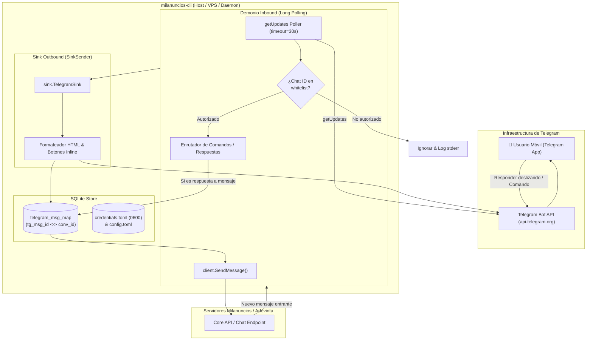
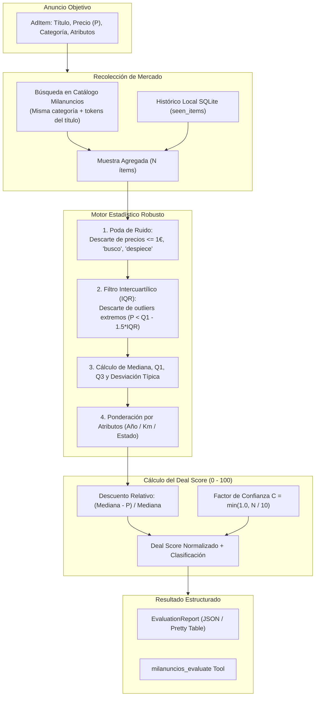
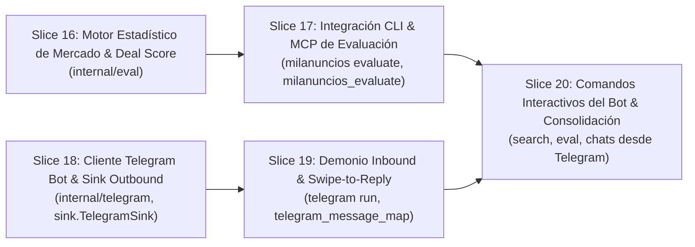

# Especificación Técnica de v0.3.0: Telegram Bot Bidireccional & Motor Deal Score

**Documento:** `docs/milanuncios-cli/03-v030-telegram-and-dealscore-specification.md`  
**Versión:** 1.0.0-draft  
**Estado:** Propuesta de Diseño Técnico para v0.3.0  
**Audiencia:** Desarrolladores core, agentes autónomos de IA y usuarios de producción.  
**Principios Rectores:** Zero-CGO, estricta separación I/O, cero "AI slop", modelos estadísticos transparentes y explicables, seguridad exhaustiva en mensajería móvil y arquitectura resiliente a caídas.

---

## 1. Visión y Objetivos de la Versión 0.3.0

Con la base de v0.2.0 consolidada (búsqueda, publicación declarativa, ciclo de vida, mensajería y servidor MCP), la versión 0.3.0 eleva la herramienta resolviendo dos necesidades críticas del usuario real y del agente autónomo:

1. **Gestión Remota desde el Móvil (Telegram Bot Bidireccional)**:
   - Recibir notificaciones en tiempo real en Telegram cuando un comprador escribe o un favorito baja de precio.
   - Responder al chat de Milanuncios directamente **deslizando y contestando al mensaje en Telegram**, sin abrir la web ni la app de Milanuncios.
   - Ejecutar consultas rápidas de estado (`/chats`, `/status`, `/eval <id>`) desde cualquier lugar sin exponer puertos abiertos ni configurar dominios con SSL (arquitectura *Long Polling* pura).

2. **Detección Objetiva de Chollos (Deal Score & Evaluador de Precios)**:
   - Eliminar la subjetividad y las alucinaciones al buscar oportunidades.
   - Un motor estadístico determinista que analiza la dispersión de precios en el mercado para una categoría y modelo específico (mediana, rango intercuartílico IQR para poda de anomalías, percentiles de mercado).
   - Generación de un **Deal Score (0–100)** acompañado de un desglose explicable (*"22% por debajo de la mediana basada en 34 anuncios comparables"*).
   - Integración nativa en CLI (`milanuncios evaluate <id>`, `milanuncios search --min-deal-score 75`) y herramienta MCP para agentes (`milanuncios_evaluate`).

---

## 2. Especificación: Telegram Bot Bidireccional



### 2.1. Arquitectura de Red y Transporte: Long Polling vs Webhooks
- **Decisión de Diseño:** Se implementa **Long Polling (`getUpdates`)**.
- **Justificación Técnica:**
  - Los webhooks exigen una IP pública estática, abrir puertos en el router/firewall y un certificado SSL válido.
  - El usuario común y los agentes suelen ejecutar el CLI en portátiles personales, detrás de NAT domésticos o en contenedores efímeros.
  - El Long Polling (`getUpdates?timeout=30&allowed_updates=["message","callback_query"]`) funciona instantáneamente sin abrir puertos, con reconexión automática ante cortes de red y latencia inferior a 200 ms.

### 2.2. Modelo de Seguridad y Whitelisting Estricto
Dado que el bot tiene acceso a responder mensajes y leer datos de la cuenta de Milanuncios del usuario, la seguridad es prioritaria:

1. **Almacenamiento de Secretos**:
   - El token del bot (`bot_token`) se almacena en `$XDG_CONFIG_HOME/milanuncios-cli/credentials.toml` (permisos `0600`) o mediante la variable de entorno `MILANUNCIOS_TELEGRAM_TOKEN`. Nunca en repositorios ni en `stdout`.
2. **Whitelist de Chat IDs Obligatoria**:
   - En `config.toml`:
     ```toml
     [telegram]
     enabled = true
     allowed_chat_ids = [123456789] # ID numérico del usuario en Telegram
     auto_mark_read = true
     ```
   - **Regla de Rechazo**: Si un mensaje proviene de un `chat.id` no presente en `allowed_chat_ids`, el mensaje se descarta de forma silenciosa y se registra un aviso en `stderr`. Nadie en Telegram puede interactuar con el bot salvo el dueño del bot.

### 2.3. Mapeo Bidireccional de Mensajes (`telegram_msg_map`)
Para que el usuario pueda contestar simplemente usando la función "Responder" (*Swipe to Reply*) de Telegram:

* **Esquema SQLite**:
  ```sql
  CREATE TABLE IF NOT EXISTS telegram_message_map (
      telegram_msg_id   INTEGER PRIMARY KEY,
      conversation_id   TEXT NOT NULL,
      ad_id             TEXT NOT NULL,
      ad_title          TEXT NOT NULL,
      opponent_name     TEXT NOT NULL,
      created_at        TIMESTAMP DEFAULT CURRENT_TIMESTAMP
  );

  CREATE INDEX IF NOT EXISTS idx_tg_map_conv ON telegram_message_map(conversation_id);
  ```

* **Flujo Operativo**:
  1. Llega un mensaje en Milanuncios de "Carlos M." sobre "Bicicleta Cannondale".
  2. `sink.TelegramSink` envía un mensaje a Telegram con formato:
     ```html
     💬 <b>Mensaje de Carlos M.</b> en <i>Bicicleta Cannondale (1250 €)</i>:
     "¿Sigue disponible? Me interesa recogerla mañana."
     
     <i>ℹ️ Desliza este mensaje para responder directamente.</i>
     ```
  3. La API de Telegram devuelve `message_id: 4892`.
  4. El CLI guarda `4892 -> (conv-8849201, 492817294, "Bicicleta Cannondale", "Carlos M.")`.
  5. En Telegram, el usuario desliza el mensaje y escribe: *"Sí, sigue disponible. ¿A qué hora te viene bien?"*.
  6. El poller detecta `update.message.reply_to_message.message_id == 4892`.
  7. El CLI busca en `telegram_message_map`, recupera `conv-8849201` y ejecuta:
     ```go
     s.Client.SendMessage(ctx, "conv-8849201", "Sí, sigue disponible. ¿A qué hora te viene bien?")
     ```
  8. Envía una confirmación sutil en Telegram (reacción emoji 👍 o mensaje efímero: *"✓ Enviado a Carlos M."*).

### 2.4. Comandos del Bot en Telegram

| Comando | Descripción | Ejemplo de Salida |
|---|---|---|
| `/chats` | Lista los últimos 5 chats activos con badges de no leídos. | Botones inline para ver cada conversación o contestar. |
| `/show <id>` | Muestra los últimos 10 mensajes de una conversación. | Cronología ordenada con remitente y hora. |
| `/search <query>` | Ejecuta una búsqueda y devuelve los 3 mejores resultados con Deal Score. | Tarjeta con foto, precio, % descuento y enlace. |
| `/eval <id\|url>` | Analiza un anuncio de Milanuncios y devuelve su Deal Score. | Mediana, rango de precios y veredicto. |
| `/watches` | Muestra el estado de los monitores activos en background. | Lista de búsquedas y favoritos monitorizados. |
| `/status` | Comprueba conexión con Milanuncios y sesión activa. | *"Sesión válida (gek0v). 3 watches activos."* |

### 2.5. Subcomandos CLI Asociados
```bash
# Iniciar el demonio bidireccional en primer plano o servicio
milanuncios telegram run

# Comprobar conectividad con Telegram Bot API y validar token
milanuncios telegram test

# Configurar token y chat ID de forma guiada
milanuncios telegram setup
```

---

## 3. Especificación: Evaluador de Precios & Motor "Deal Score"



### 3.1. Fundamentación Matemática del Deal Score (Cero "AI Slop")

Para evitar scores arbitrarios o basados en heurísticas opacas, el Deal Score se basa en **estadística no paramétrica**:

1. **Uso de la Mediana sobre la Media**:
   En mercados de segunda mano, la media aritmética sufre graves desviaciones debido a anuncios trampa (ej. coches a 1 € para llamar la atención o artículos con precios disparatados de prueba). La **mediana ($P_{median}$)** representa con precisión el precio típico de mercado.

2. **Detección y Poda de Anomalías mediante Rango Intercuartílico (IQR)**:
   - Se ordenan los precios de la muestra: $P_1 \le P_2 \le \dots \le P_N$.
   - Se calcula el primer cuartil ($Q_1$, percentil 25) y tercer cuartil ($Q_3$, percentil 75).
   - $IQR = Q_3 - Q_1$.
   - Los límites admisibles se fijan en:
     $$P_{min\_valid} = \max(5.0, Q_1 - 1.5 \times IQR)$$
     $$P_{max\_valid} = Q_3 + 1.5 \times IQR$$
   - Todos los precios fuera de este rango se excluyen del cálculo estadístico de mercado.

3. **Cálculo del Descuento Relativo ($\Delta$)**:
   $$\Delta = \frac{P_{median} - P_{anuncio}}{P_{median}}$$

4. **Factor de Confianza Basado en Tamaño Muestral ($C$)**:
   Si la muestra analizada contiene pocos anuncios comparables, la fiabilidad matemática se reduce:
   $$C = \min\left(1.0, \frac{N_{limpia}}{10}\right)$$
   *(Si $N < 4$, el score se acompaña de advertencia `low_sample_confidence: true`)*.

5. **Función de Mapeo del Deal Score (0 a 100)**:
   - $\Delta = 0$ (Precio igual a la mediana de mercado) $\rightarrow \text{Score} = 65$ (Precio Justo).
   - $\Delta > 0$ (Más barato que la mediana):
     $$\text{Score} = 65 + \left(35 \times \min(1.0, \frac{\Delta}{0.35})\right) \times C$$
     *(Un 35% de descuento sobre la mediana con alta confianza otorga un Score de 100)*.
   - $\Delta < 0$ (Más caro que la mediana):
     $$\text{Score} = \max\left(10, 65 - \left(55 \times \min(1.0, \frac{|\Delta|}{0.50})\right)\right)$$
     *(Un 50% por encima de la mediana reduce el score a 10)*.

### 3.2. Escala Canónica de Calificación

| Rango Deal Score | Calificación (`rating`) | Significado de Negocio | Color Visual |
|:---:|:---:|---|:---:|
| **85 – 100** | `super_deal` | **Chollo Excepcional**: Precio significativamente inferior a la mediana. Alta probabilidad de venta rápida. | 🟢 Verde Brillante |
| **70 – 84** | `great_price` | **Muy Buen Precio**: Entre un 10% y 25% por debajo del mercado. | 🟢 Verde |
| **50 – 69** | `fair_price` | **Precio Justo / De Mercado**: Alineado con la mediana del mercado. | 🟡 Amarillo |
| **35 – 49** | `high_price` | **Precio Elevado**: Entre un 10% y 25% por encima de lo habitual. | 🟠 Naranja |
| **0 – 34** | `overpriced` | **Sobreprecio / Desproporcionado**: Más de un 25% por encima del mercado. | 🔴 Rojo |

---

### 3.3. Estructuras de Datos en Go (`internal/eval/types.go`)

```go
package eval

import (
	"time"

	"github.com/gek0v/milanuncios-cli/internal/milanuncios"
)

// DealRating clasifica la calidad del precio.
type DealRating string

const (
	RatingSuperDeal  DealRating = "super_deal"
	RatingGreatPrice DealRating = "great_price"
	RatingFairPrice  DealRating = "fair_price"
	RatingHighPrice  DealRating = "high_price"
	RatingOverpriced DealRating = "overpriced"
)

// EvaluationReport contiene el análisis exhaustivo de precio de un anuncio.
type EvaluationReport struct {
	AdID             string             `json:"ad_id"`
	Title            string             `json:"title"`
	Price            float64            `json:"price"`
	CategoryID       int                `json:"category_id"`
	CategoryName     string             `json:"category_name,omitempty"`
	URL              string             `json:"url"`
	DealScore        int                `json:"deal_score"`          // 0 a 100
	Rating           DealRating         `json:"rating"`              // super_deal, great_price, etc.
	DiscountPercent  float64            `json:"discount_percent"`    // Ej. 21.5%
	MarketMedian     float64            `json:"market_median"`       // Mediana depurada
	MarketQ1         float64            `json:"market_q1"`           // Primer cuartil (25%)
	MarketQ3         float64            `json:"market_q3"`           // Tercer cuartil (75%)
	SampleSize       int                `json:"sample_size"`         // N de anuncios comparados
	Confidence       float64            `json:"confidence"`          // 0.0 a 1.0
	Verdict          string             `json:"verdict"`             // Explicación textual humana
	PriceHistory     []PricePoint       `json:"price_history,omitempty"`
	Comparables      []ComparableAd     `json:"comparables,omitempty"`
	EvaluatedAt      time.Time          `json:"evaluated_at"`
}

type PricePoint struct {
	Date  string  `json:"date"`
	Price float64 `json:"price"`
}

type ComparableAd struct {
	ID         string  `json:"id"`
	Title      string  `json:"title"`
	Price      float64 `json:"price"`
	Similarity float64 `json:"similarity"`
	URL        string  `json:"url"`
}
```

---

### 3.4. Interfaz CLI y Salida de Ejemplo

#### A. Comando Directo de Evaluación
```bash
milanuncios evaluate 492817294 --format pretty
```

*Salida Pretty en Terminal:*
```text
======================================================================
  📊 EVALUACIÓN DE PRECIO & DEAL SCORE
======================================================================
Anuncio:  Cannondale Topstone 1 Gravel (Talla M)
ID:       492817294
Precio:   950 €

RESULTADO:
  Deal Score:        84 / 100  [★★★★☆]
  Calificación:      MUY BUEN PRECIO (great_price)
  Descuento:         -20.8% frente a la mediana de mercado

BENCHMARK DE MERCADO:
  Mediana:           1.200 €
  Rango Típico:      1.050 € (Q1) - 1.350 € (Q3)
  Muestra analizada: 26 anuncios similares (Confianza: 95%)

HISTÓRICO DEL ANUNCIO:
  10/11/2026: 1.100 €
  18/11/2026:   950 €  (Bajada de 150 €)

VEREDICTO:
  El anuncio se encuentra 250 € por debajo de la mediana del mercado
  para bicicletas Cannondale Topstone 1 en estado similar.
======================================================================
```

*Salida JSON estructurada (`--format json`):*
```json
{
  "ad_id": "492817294",
  "title": "Cannondale Topstone 1 Gravel (Talla M)",
  "price": 950.0,
  "category_id": 1102,
  "url": "https://www.milanuncios.com/bicicletas/cannondale-topstone-1-492817294.htm",
  "deal_score": 84,
  "rating": "great_price",
  "discount_percent": 20.8,
  "market_median": 1200.0,
  "market_q1": 1050.0,
  "market_q3": 1350.0,
  "sample_size": 26,
  "confidence": 0.95,
  "verdict": "El anuncio se encuentra 250 € por debajo de la mediana del mercado para bicicletas Cannondale Topstone 1.",
  "evaluated_at": "2026-11-18T20:25:00Z"
}
```

#### B. Filtro de Chollos en Búsqueda
Permite encontrar gangas directamente desde la terminal o mediante subagentes:
```bash
milanuncios search "macbook air m1" --min-deal-score 75 --format json
```
El motor calcula al vuelo el Deal Score de los resultados y descarta automáticamente los anuncios con precio de mercado ordinario o sobreprecio.

---

### 3.5. Nueva Herramienta MCP: `milanuncios_evaluate`

```json
{
  "name": "milanuncios_evaluate",
  "description": "Evaluate the fair market price and calculate the Deal Score (0-100) of an ad listing. Uses robust non-parametric statistical benchmarks (IQR outlier cleaning and median comparison) to detect real bargains without AI hallucinations.",
  "inputSchema": {
    "type": "object",
    "properties": {
      "ad_id": {
        "type": "string",
        "description": "Ad ID or full Milanuncios URL to evaluate"
      },
      "include_comparables": {
        "type": "boolean",
        "default": false,
        "description": "Include top comparable listings in the output"
      }
    },
    "required": ["ad_id"]
  }
}
```

---

## 4. Desglose de Implementación por Slices Verticales (v0.3.0)

Para garantizar la máxima calidad de software, cero regresiones y cobertura total de tests (unitarios y E2E), el desarrollo se dividirá en 5 slices incrementales:



| Slice | Nombre | Entregables Principales | Criterios de Aceptación (Testing) |
|:---:|---|---|---|
| **Slice 16** | Motor Estadístico de Mercado (`internal/eval`) | - Algoritmo de poda IQR y mediana.<br>- Extractor de muestra de mercado.<br>- Cálculo de `DealScore` y `DealRating`. | Cobertura unitaria exhaustiva: tests con distribuciones sintéticas con outliers extremos (precios 1€, precios absurdos), cálculo de confianza con $N < 5$ y $N > 20$. |
| **Slice 17** | Comandos CLI y MCP de Evaluación | - `milanuncios evaluate <id\|url>`.<br>- Flag `--min-deal-score` en `search`.<br>- Herramienta MCP `milanuncios_evaluate`. | Tests CLI en `internal/cli/eval_test.go` con formatos `json`, `pretty`, `toon`. E2E black-box verificando exit codes semánticos (4 en ad no encontrado). |
| **Slice 18** | Cliente Telegram & Sink Outbound | - Cliente HTTP puro sin dependencias externas para Telegram Bot API.<br>- `sink.TelegramSink` en `internal/sink/`.<br>- Configuración de bot token y chat IDs. | Mock server de Telegram para tests unitarios. Verificar que alertas de precio y mensajes entrantes generan mensajes formateados en Telegram con botones inline. |
| **Slice 19** | Demonio Inbound & Swipe-to-Reply | - Bucle `getUpdates` con reconexión.<br>- Tabla SQLite `telegram_message_map`.<br>- Detección de `reply_to_message` y llamada a `Client.SendMessage`. | Test de integración: simular un mensaje de Telegram respondiendo a una notificación previa y comprobar que el CLI llama correctamente al endpoint de chat de Milanuncios. |
| **Slice 20** | Comandos del Bot & Consolidación v0.3.0 | - Handlers de `/search`, `/eval`, `/chats`, `/status`.<br>- Subcomando `milanuncios telegram setup`.<br>- Documentación completa en `docs/commands/`. | Suite E2E completa (95+ tests pasando). Verificación de seguridad: mensajes de chat IDs no autorizados se rechazan al 100%. |

---

## 5. Matriz de Seguridad y Gestión de Riesgos

1. **Riesgo de Suplantación en Telegram**:
   - *Mitigación:* Validación estricta en cada payload entrante: `if !isAllowedChatID(update.Message.Chat.ID) { drop() }`. Ningún comando o respuesta se ejecuta sin pasar este filtro.
2. **Riesgo de Sobrecarga de Peticiones en Milanuncios para Evaluar**:
   - *Mitigación:* Cacheo en SQLite local de los benchmarks de categoría durante 2 horas. Si se evalúan 5 anuncios de la misma categoría en poco tiempo, no se repite la recolección masiva.
3. **Muestras Sesgadas o Escasas**:
   - *Mitigación:* Si la muestra depurada tiene menos de 4 artículos, `confidence` cae por debajo de 0.4 y el reporte advierte explícitamente: *"Muestra insuficiente para valoración estadística definitiva"*.
